# Architecture

A cloud-native, event-driven food ordering platform built from **seven independently deployable
microservices**. This document covers the architecture, service boundaries, database ownership,
communication patterns, event contracts and the deployment strategy.

> **Implementation status:** all seven services (Auth, Catalog, Order, Payment, Billing, Notification, Delivery), the developer
> tooling (Stage 8), many-to-many restaurant administration (Stage 8.2) and account deletion (Stage 9) are implemented and tested **locally only**. Nothing is
> deployed. See [PROGRESS.md](PROGRESS.md). New to the project? Start with [TEAM_HANDOVER.md](TEAM_HANDOVER.md).
>
> Where to look:
> - one card per service: [§21](#21-service-reference);
> - communication model: [§16](#16-final-communication-architecture-event-driven-choreography);
> - Notification Service: [§17](#17-notification-service);
> - Delivery Service: [§18](#18-delivery-service-stage-6);
> - restaurant administration: [§20](#20-restaurant-administration-many-to-many-assignments-stage-82);
> - permanent account deletion: [§23](#23-permanent-account-deletion-stage-9);
> - cloud requirements: [DEPLOYMENT_GUIDE.md](DEPLOYMENT_GUIDE.md).

---

## 1. System overview

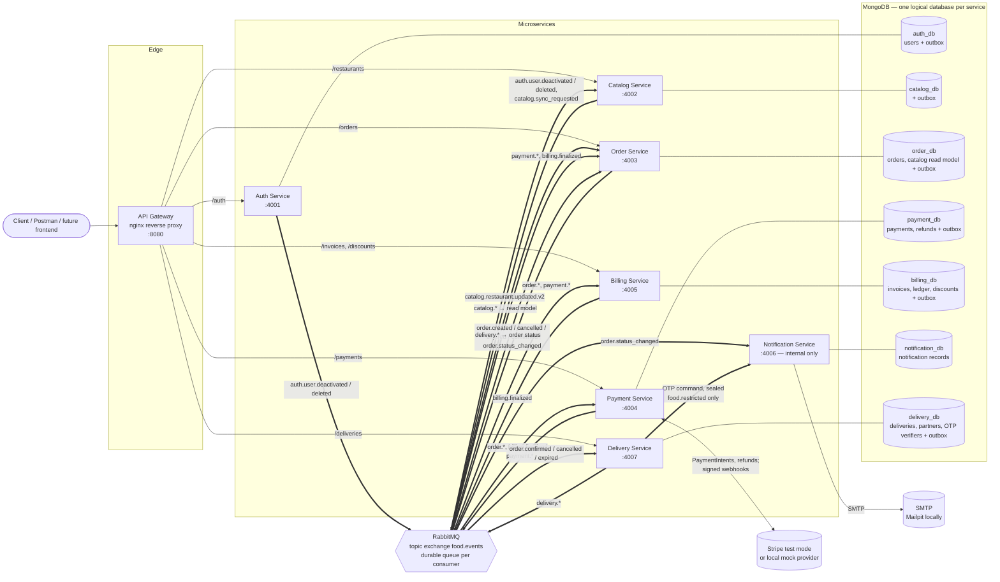

Every service-to-service arrow goes through RabbitMQ (the OTP command through the separate `food.restricted` exchange):
**no service calls another service over HTTP** (see the audit in §16.2). Clients use REST through the gateway only.

### Design principles

1. **Each service owns its data.** No service reads another service's database. Data crosses
   service boundaries only as events; clients reach services through the gateway's REST APIs.
2. **No synchronous service-to-service calls.** A service that needs another service's data keeps a
   versioned local read model built from events (e.g. the Order Service's catalog projection) and refuses
   to act when that model may be stale, instead of calling out or silently using old data.
3. **Choreography, not orchestration.** Each service reacts to facts (events) and publishes its own facts
   via a transactional outbox. Producers don't know or wait for their consumers; there is no orchestrator.
4. **Stateless services.** All state lives in MongoDB/RabbitMQ, so any service can scale horizontally
   or be restarted without coordination.
5. **Shared code is infrastructure only.** `packages/common` contains logging, config, error handling,
   JWT verification, the RabbitMQ client and event *contracts*. It contains no business rules.
6. **Simple over clever.** One topic exchange, JSON events, HS256 JWTs, a polling outbox. Each is
   easy to explain, demonstrate and debug.

---

## 2. Repository layout

The complete annotated tree and a "where do I find…" table are in [TEAM_HANDOVER.md §5](TEAM_HANDOVER.md#5-repository-navigation). In short:

```
.
├── packages/common/          # @food/common: shared infrastructure + event contracts (no business logic)
│   └── src/  auth.ts config.ts db.ts errors.ts idempotency.ts lifecycle.ts logger.ts
│             events/ (envelope, contracts)  http/ (base app, RBAC, validation, health)
│             messaging/ (RabbitMQ broker)  outbox/ (enqueue, relay)  crypto/ (sealed box for OTPs)
├── services/                 # auth, catalog, order, payment, billing, notification, delivery
│                             # each: src/, test/, Dockerfile, .env.example, package.json
├── infra/nginx/              # API gateway image (nginx config baked in)
├── infra/rabbitmq-setup/     # one-shot broker provisioning job
├── tools/devtools/           # development-only testing console, Swagger UI, observability helpers
├── docs/                     # OpenAPI source (openapi.mjs) and generated openapi.json
├── scripts/                  # init-env, seed-delivery-agents, openapi check, e2e-*.mjs, scenarios.mjs
└── docker-compose.yml        # full local environment
```

Each service follows the same layered structure:

```
src/
  config.ts       # service-specific env schema
  models/         # Mongoose schemas (persistence layer)
  services/       # business logic (no Express types)
  routes/         # HTTP layer: validation → service call → response
  schemas.ts      # zod request schemas
  app.ts          # createApp(config, logger, deps): testable, no side effects
  server.ts       # composition root: connect DB/broker, start HTTP, graceful shutdown
```

`app.ts` takes its dependencies (catalog client, event hooks) as parameters, so tests run the real HTTP
stack against an in-memory MongoDB replica set without starting other services.

---

## 3. Service boundaries

| Service | Owns | Responsibilities | Status |
|---|---|---|---|
| **Auth** | users, credentials, roles | registration, login, bcrypt hashing, JWT issuance, profile & saved addresses, admin user management incl. permanent deletion of inactive accounts; publishes `auth.user.deactivated` and `auth.user.deleted` through its outbox (§20, §23) | ✅ |
| **Catalog** | restaurants, menu items, administrator assignments (`adminIds`) | restaurant & menu CRUD, availability, operating status, search/filter, many-to-many administrator assignments (§20) | ✅ |
| **Catalog** *(events)* | — | publishes a versioned restaurant + menu snapshot (`catalog.restaurant.updated`) on every change, at startup, periodically and on request | ✅ |
| **Order** | orders, order outbox, catalog read model | order placement priced from the local catalog read model, **sole authority over order status and history** (payment, billing and delivery facts arrive as events), tracking view, cancellation, payment deadline + expiration worker, customer-facing `order.status_changed` events | ✅ |
| **Payment** | payments, refunds, provider ids | Stripe test-mode PaymentIntents, webhook verification, automatic cancellation/refunds, payment events | ✅ |
| **Billing** | invoices, billing ledger, discount codes | itemised immutable invoices, subtotal verification, discounts, final payable amount (tax = 0 for now), refund/cancellation/expiry adjustments | ✅ |
| **Notification** | notification records | internal only (no gateway route): consumes `order.status_changed`, renders HTML + text templates, sends email over SMTP (Mailpit locally) with durable retries and per-transition deduplication | ✅ |
| **Delivery** | deliveries, delivery partners, OTP verifiers | delivery per confirmed order, simulated preparation, random atomic partner assignment, partner pickup/arrival/OTP REST API, keyed-hash OTPs with expiry, attempt and reissue limits, restricted OTP command, `delivery.*` events | ✅ |

### Roles

| Role | Created by | Can |
|---|---|---|
| `customer` | self-registration (`POST /auth/register`) | browse, order, view/cancel own orders |
| `restaurant_admin` | platform admin (`POST /auth/users`) and assigned to restaurants by a platform admin | view and update the restaurants **assigned** to them (details, menu, prices, availability, open/close), view and cancel their orders; cannot create restaurants or change assignments |
| `delivery_agent` | platform admin (`POST /auth/users`; `scripts/seed-delivery-agents.mjs` seeds 12) | register availability, pick up, mark arrival and verify the OTP of deliveries assigned to them |
| `platform_admin` | bootstrapped from `ADMIN_EMAIL`/`ADMIN_PASSWORD` | everything, including creating restaurants, administrator assignments and user moderation |

Public registration **always** creates a `customer`. Privileged accounts can only be created by a
platform admin.

---

## 4. Database ownership

Locally, a single MongoDB server (single-node replica set) hosts **one logical database per service**.
Each service receives only its own connection string:

| Service | Database | Collections |
|---|---|---|
| auth-service | `auth_db` | `users`, `outbox_events` |
| catalog-service | `catalog_db` | `restaurants`, `menuitems`, `outbox_events` |
| order-service | `order_db` | `orders`, `catalog_restaurants` (read model), `outbox_events`, `processed_events` |
| payment-service | `payment_db` | `payments`, `refunds`, `processed_events`, `outbox_events`, `mock_provider_objects` (mock provider only) |
| billing-service | `billing_db` | `invoices` (immutable), `billing_entries` (immutable ledger), `discounts`, `processed_events`, `outbox_events` |
| notification-service | `notification_db` | `notifications` (unique `dedupeKey` per order + status; no separate processed-events table is needed) |
| delivery-service | `delivery_db` | `deliveries` (unique `orderId`), `delivery_agents` (unique partial `activeDeliveryId`), `delivery_otps` (unique `(deliveryId, sequence)`, one `active` per delivery), `processed_events`, `outbox_events` |

**Physically shared, logically separate.** Locally, all seven databases live in one `mongod` process: one container, one
`mongo-data` volume. Each service still receives a `MONGO_URI` naming only its own database, and no code ever opens another. The local MongoDB has
**no authentication**, so this isolation holds by convention only. In a cloud deployment every service should get its **own database user, scoped to its own database**,
so that credentials enforce the isolation. This is not implemented yet; see [DEPLOYMENT_GUIDE §5](DEPLOYMENT_GUIDE.md#5-mongodb).

**Why a service must never write another service's database:**
- the write would bypass the owner's invariants: state machines, immutability (invoices, ledger), version counters (`catalogVersion`), compare-and-set guards;
- the write publishes **no event**, so every projection built from that owner's events silently diverges;
- schemas and indexes could no longer evolve independently;
- the database could no longer move to its own server.

**Cross-service references are plain IDs.** For example, `order.customerId` is the Auth user id and
`order.restaurantId` is the Catalog id. They are not foreign keys, and no join ever crosses a service
boundary. The Order Service keeps **snapshots** (item name, unit price, restaurant name) because
historical orders must not change when a menu is edited. Its `catalog_restaurants` collection is a
disposable read model of Catalog data, fed only by Catalog events (§16.5); the Catalog stays the authority.

**Why a replica set locally?**
- **Transactions:** every publishing service writes its change *and* its outbox event in one multi-document transaction, and so does `processOnce`. MongoDB transactions need a replica set.
- **Change streams:** the Order Service's live tracking uses one, which also needs a replica set.

The Compose healthcheck initiates a single-node set `rs0` (member `mongo:27017`) on first boot. Atlas clusters are always replica sets.

**Important indexes and uniqueness constraints** (declared in each `models/*.ts`; Mongoose creates them at startup):

| Database | Constraint |
|---|---|
| `auth_db` | `users.email` unique; `role` index |
| `catalog_db` | `restaurants.slug` unique; `adminIds` index; `(status, address.city, rating)`; `menuitems (restaurantId, name)` unique |
| `order_db` | `orders.orderNumber` unique; `(customerId, idempotencyKey)` unique partial; `(status, expiresAt)` for the expiry sweep |
| `payment_db` | `payments.orderId` unique (one payment per order); `providerPaymentIntentId` unique partial; `refunds.idempotencyKey` unique |
| `billing_db` | `invoices.orderId` and `invoiceNumber` unique; `billing_entries (kind, reference)` unique; `discounts.code` unique |
| `delivery_db` | `deliveries.orderId` unique; `delivery_agents.activeDeliveryId` unique partial (no double booking); `delivery_otps (deliveryId, sequence)` unique, one `active` per delivery |
| `notification_db` | `notifications.dedupeKey` unique (one email per order + status / OTP sequence) |
| every `outbox_events` | `(status, createdAt)`; TTL on `publishedAt` (7 days) |
| every `processed_events` | `_id` = `<consumer>:<eventId>` |

**Initialization and migrations.** Nothing is run by hand. Mongoose builds indexes, and each service runs its own idempotent startup steps:

| Service | Startup step |
|---|---|
| Auth | creates the bootstrap platform admin from `ADMIN_EMAIL`/`ADMIN_PASSWORD` if absent |
| Billing | seeds discount codes (`SEED_DISCOUNTS`) |
| Catalog | seeds the full demo catalog only when `SEED_ON_START=true`; runs the `ownerId → adminIds` migration (§20.5) |
| Order | migrates its projection the same way |

Data persists in the `mongo-data` Docker volume until `docker compose down -v`.

**Money** is always stored and transmitted as **integer paise** (₹249.00 → `24900`) to avoid
floating-point rounding errors.

---

## 5. Communication

### 5.1 Synchronous (REST): clients only

| Caller → Callee | Call | Why synchronous |
|---|---|---|
| Client → any client-facing service (via gateway) | REST/JSON + JWT | user-facing request/response |
| Payment ↔ Stripe (or the local mock) | PaymentIntents / refunds API; signed webhooks back | external provider of record for money movement |
| Notification → SMTP server | SMTP | external delivery channel (Mailpit locally) |

**There are no synchronous service-to-service calls.** The four internal HTTP dependencies that
existed up to Stage 5 (Order → Catalog ×2, Payment → Order, Payment → Billing, Billing → Order) were
replaced by events and local read models; see the audit in §16.2. The `callService()` helper (timeouts,
`x-request-id` propagation, 503 mapping) remains in `@food/common` but no service uses it.

**JWT verification is local.** Every service verifies tokens with the shared HS256 secret, so there's
no network call to the Auth Service on each request. If Auth is down, existing sessions keep working.
(RS256 with a JWKS endpoint is the natural upgrade if secret sharing becomes a concern.)

### 5.2 Asynchronous (RabbitMQ)

- One durable **topic exchange** for all business events, `food.events`, plus one durable **direct exchange**, `food.restricted`, for the OTP command only (§16.7).
- **Routing key** = `<eventType>.v<version>`, e.g. `order.created.v1`.
- Each consuming service declares **its own durable queue** (e.g. `payment-service.order-events`)
  bound to the routing keys it cares about. Several services can each receive every event.
- Messages are **persistent**, and the publisher uses **publisher confirms**.

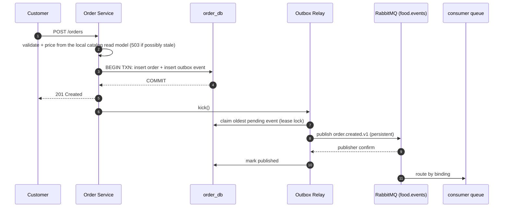

---

## 6. Event contracts

All events share one envelope (`packages/common/src/events/envelope.ts`):

```json
{
  "eventId": "uuid — idempotency key for consumers",
  "eventType": "order.created",
  "version": 1,
  "occurredAt": "2026-10-15T13:40:12.345Z",
  "source": "order-service",
  "correlationId": "request id that triggered the event",
  "data": { "...": "contract-specific payload" }
}
```

Payloads are defined as **zod schemas** in `packages/common/src/events/contracts.ts`. Producers validate
an event *before* writing it to the outbox, so an invalid event aborts the business transaction instead
of failing at publish time. Consumers validate on receipt.

The complete, current event matrix (publishers, consumers, business keys) is in **§16.3**. Summary:

| Producer | Events |
|---|---|
| Auth | `auth.user.deactivated.v1`, `auth.user.deleted.v1` |
| Catalog | `catalog.restaurant.updated.v2` (v1 retired in Stage 8.2) |
| Order | `order.created.v1`, `order.confirmed.v1`, `order.cancelled.v1`, `order.expired.v1`, `order.status_changed.v1`, `catalog.sync_requested.v1` |
| Billing | `billing.finalized.v1` (legacy `billing.invoice_generated.v1` still accepted by consumers) |
| Payment | `payment.succeeded.v1`, `payment.failed.v1`, `payment.cancelled.v1`, `payment.refund.completed.v1`, `payment.refund.failed.v1` |
| Delivery | `delivery.ready_for_pickup.v1`, `delivery.partner_assigned.v1`, `delivery.picked_up.v1`, `delivery.location_reached.v1`, `delivery.completed.v1`, `delivery.cancelled.v1`, `delivery.assignment_failed.v1`; restricted `notification.delivery_otp.v1` (on `food.restricted`) |
| Notification | (consumes only; publishes nothing) |

**Versioning rules:** adding an optional field is non-breaking (same version). Removing or renaming a
field, or changing its meaning, is breaking: publish `vN+1` alongside `vN` until every consumer has
migrated, then retire `vN`.

---

## 7. Reliability

### 7.1 Transactional outbox (every publishing service)

Every publishing service uses the same outbox: Auth, Catalog, Order, Payment, Billing and Delivery all call `enqueueEvent` and run an `OutboxRelay`, from
`packages/common/src/outbox/`. The Notification Service publishes nothing. The outbox is described here for the Order Service, where it was introduced.

**Problem:** "save order, then publish event" can fail halfway. The order could be saved with no event
sent (downstream never hears of it), or an event sent for an order that was rolled back.

**Solution:** the order and an `outbox_events` document are written in **one MongoDB transaction**.
A relay (`packages/common/src/outbox/relay.ts`) then publishes pending events:

- triggered right after each commit (`kick()`), plus a poll every second as a safety net;
- **oldest-first, stopping at the first failure**, which preserves per-order ordering
  (created before cancelled);
- an event is marked `published` only **after the broker confirms** it, giving at-least-once delivery;
- exponential backoff while the broker is down; events simply wait in MongoDB;
- events are **claimed with a lease lock**, so multiple Order Service replicas don't publish the same
  event concurrently;
- published events are TTL-deleted after 7 days.

This was verified live: with RabbitMQ stopped, `POST /orders` still returns **201** and `/health`
reports `degraded`. The event sits in the outbox and is published automatically once RabbitMQ is
back (see PROGRESS.md).

### 7.2 Consumers: acks, retries, DLQ, idempotency

`MessageBroker.subscribe()` (in `@food/common`, integration-tested against real RabbitMQ) provides:

```
food.events ──binding──► <svc>.queue ──handler ok──► ack
                             │  handler throws
                             ▼
                        <svc>.queue.retry  (TTL = retryDelayMs, dead-letters back to <svc>.queue)
                             │  after maxRetries
                             ▼
                        <svc>.queue.dlq    (inspect / replay manually)
```

- **Manual acks.** A message is removed only after its handler succeeds.
- **Bounded retries** through a TTL retry queue, so a failing message doesn't spin in a hot loop.
- **Dead-letter queue** for messages that keep failing, and immediately for malformed messages.
- **Idempotency:** `processOnce(consumer, eventId, fn)` records `(consumer, eventId)` in
  `processed_events` and applies `fn`'s writes **in the same transaction**. A redelivered event is
  skipped, and a crash can never leave an event marked as processed without its effects applied. It is used by the Order Service's payment, billing and delivery consumers and by
  the Payment, Billing and Delivery consumers. Three consumers are idempotent by state instead:
  - the Order Service's catalog projection applies only a newer `catalogVersion`;
  - the Notification Service has a unique `dedupeKey` per order and status;
  - the Catalog Service's `auth.user.deactivated` cleanup removes only assignments older than the event, its `auth.user.deleted` cleanup has nothing left to remove on a repeat, and its sync-request consumer simply re-broadcasts;
  - the Delivery Service's account blocks (`$max`/`$min` on dates) and the Auth Service's agent-delivery projection (upserts keyed by delivery id, "closed" is terminal) are idempotent by state too (§23).

### 7.3 Broker and database failures

- `amqp-connection-manager` reconnects automatically and **re-declares all topology** after each reconnect.
- MongoDB: bounded retries at startup; after that the driver reconnects transparently.
- Health checks distinguish **critical** dependencies (MongoDB → 503, so the orchestrator replaces the
  task) from **optional** ones (RabbitMQ for the Order Service → 200 `degraded`).
- **Graceful shutdown** on SIGTERM: stop accepting requests, drain the outbox relay, close the broker,
  disconnect MongoDB, exit within 10 s.

### 7.4 Idempotent order placement

Clients may send an `Idempotency-Key` header with `POST /orders`. A retry with the same key (for
example, after a network timeout) returns the original order (`200`, `Idempotent-Replayed: true`) and
never creates a duplicate. This is enforced by a unique partial index on `(customerId, idempotencyKey)`.

---

## 8. Order state machine

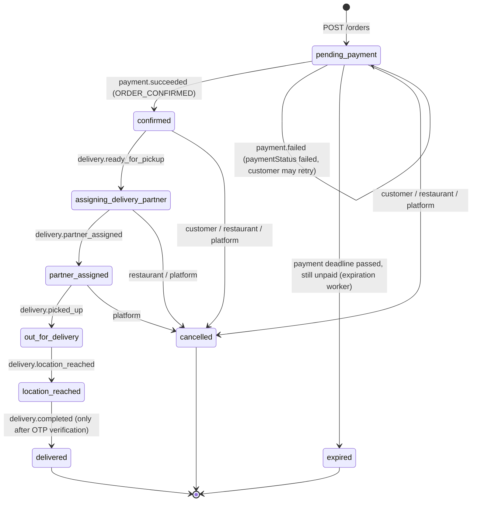

- The flow and the cancellation rights per actor are defined in `services/order/src/models/order-status.ts`
  (`FULFILMENT_FLOW`, `CANCELLABLE_BY`). The Order Service is the **only** writer of order status.
- **No REST endpoint sets a status.** The interim `PATCH /orders/:id/status` was removed. Payment and delivery
  progress arrive only as events, and the Order Service decides whether each one is a legal transition
  (rank ordering: early events are retried, stale or duplicate ones are ignored, closed orders ignore delivery events).
- Every accepted transition is one **compare-and-set** update that sets `status`, appends a `statusHistory`
  entry `{ status, at, sourceEventId, sourceService, by, role, note?, metadata? }`, and writes, in the same
  transaction, the domain event (if any) plus `order.status_changed.v1` to the outbox.
- Cancelling a **paid** order sets `paymentStatus = refund_pending`. The Payment Service issues the
  refund when it consumes `order.cancelled`.
- `GET /orders/:id/tracking` returns the expected steps (reached / current / timestamp) and the full history.
- Legacy statuses `preparing`, `ready_for_pickup` and `payment_failed` remain valid for historical documents only.

### Pricing

Prices are **never accepted from the client** (the request schema is strict and rejects `price`/`total`
fields). The Order Service prices from its catalog read model (refusing with 503 while that model may be
stale, §16.5) and computes:

```
subtotal         = Σ unitPrice × quantity          (from Catalog, at order time)
deliveryFee      = ₹40, waived when subtotal ≥ ₹499 (configurable)
provisionalTotal = subtotal + deliveryFee
```

Discounts (and, in future, taxes) are the Billing Service's job, which is why the Order Service's
figure is called *provisional*. The payable amount is `billing.finalized.finalAmount`.

---

## 9. Security

- Passwords are hashed with **bcrypt** (cost 12 by default, 10 in docker-compose) and never returned or
  logged (`select: false` plus log redaction).
- Login returns the **same error** for an unknown email and a wrong password, and compares against a
  dummy hash for unknown emails, so response timing doesn't reveal which accounts exist.
- JWTs are HS256 with **issuer and audience** checks and short expiry (1 h). `alg: none` and foreign
  secrets are rejected. Expired tokens return a distinct `TOKEN_EXPIRED` code.
- **RBAC** at the route level (`authorize(...)`), plus **ownership** checks in the business layer
  (restaurant admins manage only the restaurants whose `adminIds` include them, §20; delivery agents act only on deliveries assigned to them;
  customers see only their own orders).
  Requests for another user's resource return 404, so its existence isn't revealed.
- All input is validated with **strict zod schemas** (unknown fields rejected). Search terms are
  regex-escaped. Request bodies are limited to 100 kB.
- `helmet` security headers; the gateway rate-limits `/auth/*`.
- Account lifecycle: the last active platform admin cannot be deactivated; only **inactive** accounts can be deleted, never your own (§23).
  Already-issued JWTs remain valid until expiry after deactivation or deletion (no revocation list, §23.5).
- Secrets come from the environment only. `.env` is git-ignored, and `.env.example` files hold placeholders.

---

## 10. Observability

- **Structured JSON logs** (pino) with `service`, `level`, ISO timestamps and request id on every line.
- **Request ids** are accepted or generated at the gateway/service (`x-request-id`), returned in
  responses, and copied into events as `correlationId`. There are no service-to-service calls to forward them on.
  One order can be traced from the HTTP request through the outbox to the event.
- `GET /health` on every service (and `/health/<svc>` through the gateway) for Docker/ECS health checks.
- RabbitMQ management UI at http://localhost:15672 shows queues, rates and DLQs.
- In a cloud deployment, container stdout would go to the platform's log service (e.g. CloudWatch Logs). Alarms on DLQ depth and 5xx rates are recommended; see
  [DEPLOYMENT_GUIDE §10](DEPLOYMENT_GUIDE.md#10-logging). None of this is configured yet.

---

## 11. Deployment strategy

### Local (implemented)

`docker compose up -d --build` runs:
- MongoDB (replica set) and RabbitMQ;
- the one-shot `rabbitmq-setup` job;
- the seven services and the gateway;
- Mailpit and the development console.

Every service has its own image, its own environment and a health check. Compose is the local development environment, not a production orchestrator.

### AWS (cloud deployment proposal, **not implemented, nothing provisioned**)

> This is an early design sketch. The current, code-verified deployment requirements and blockers are in **[DEPLOYMENT_GUIDE.md](DEPLOYMENT_GUIDE.md)**.
> The repository contains no Terraform, ECS or CI configuration. Read the bullets below as options to evaluate, not as decisions.
> For example, the nginx gateway can only run on ECS after its DNS resolver and hostnames are changed (DEPLOYMENT_GUIDE §4).

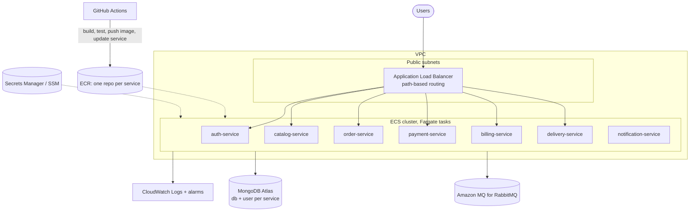

- **One ECR repository and one ECS service per microservice.** Each deploys independently. GitHub
  Actions uses path filters so a change to `services/order/**` rebuilds and redeploys only the Order
  Service; a change to `packages/common/**` rebuilds all of them.
- The **ALB replaces nginx** in the cloud, using the same path routing (`/auth/*`, `/restaurants*`, `/orders*`, …).
  The nginx gateway image remains an option for a single-task demo.
- Configuration comes from task-definition env vars; secrets (JWT secret, DB URIs, Stripe keys)
  come from **SSM Parameter Store / Secrets Manager**.
- Infrastructure *could* be written in Terraform (VPC, ALB, ECS cluster/services/task definitions, ECR,
  IAM, CloudWatch). It is not part of this repository.

**Cost notes for a student budget** (to be confirmed with current pricing before provisioning):
- Fargate: 7 tasks × 0.25 vCPU / 0.5 GB. Run them only during demos, or scale to 0 between demos.
- ALB has an hourly charge. For short demos one ALB is fine; otherwise use a single public task running
  the nginx gateway.
- MongoDB Atlas **M0 free tier** works for a demo (one cluster, separate databases/users per service).
- Amazon MQ (RabbitMQ) has **no free tier**, and the smallest broker runs ~24/7. Cheaper alternatives:
  CloudAMQP's free plan, or RabbitMQ as a Fargate task with EFS (non-HA, fine for a demo).
- Avoid a NAT Gateway (significant fixed monthly cost): use public subnets with security groups for tasks,
  or VPC endpoints.
- **No AWS resources will be created without explicit approval.**

---

## 12. Key decisions (ADR summary)

| # | Decision | Rationale |
|---|---|---|
| 1 | npm workspaces monorepo | one clone, shared tooling; each service still has its own package.json, Dockerfile and image |
| 2 | TypeScript 7, ESM, Node 24 LTS | current stable toolchain; strict typing including `noUncheckedIndexedAccess` |
| 3 | Express 5 | native async error propagation (no wrapper boilerplate) |
| 4 | zod for env, requests and events | one validation library everywhere; schemas double as documentation |
| 5 | HS256 shared-secret JWT, verified locally | simple and fast; no runtime coupling to Auth. Upgrade path: RS256 + JWKS |
| 6 | Integer paise for money | exact arithmetic; matches Stripe's smallest-unit convention |
| 7 | Single-node Mongo replica set locally | needed for transactions (outbox); matches Atlas |
| 8 | Transactional outbox in Order Service | no lost or phantom events; survives broker outages (verified) |
| 9 | Topic exchange, `type.vN` routing keys | consumers bind selectively; versions coexist |
| 10 | TTL retry queue + DLQ per consumer queue | bounded retries without hot loops; poison messages isolated |
| 11 | Deterministic seed ObjectIds (sha1 of slug) | stable IDs across machines, tests and Postman; idempotent upserts |
| 12 | Soft-delete restaurants | historical orders keep valid references |
| 13 | nginx gateway, config baked into image | single entry point with no business logic; no host bind mounts (works on ECS) |
| 14 | Order snapshots of name/price | historical orders don't change when menus change |
| 15 | Payment Service owns payment state; Order Service mirrors it via events only | clear ownership; no cross-database writes |
| 16 | One PaymentIntent per payment, idempotency key `pi:<paymentId>` | retries and concurrent clicks can never create a second charge |
| 17 | Provider calls outside DB transactions, driven by a reconciler | a transaction never waits on Stripe; crashes/outages resume from durable intent |
| 18 | Separate lifecycle vs refund-outcome transition tables | delayed webhooks cannot regress captured payments (bug found by tests) |
| 19 | Mock provider signs webhooks with Stripe's scheme | the real verification path is exercised locally; mock is labelled everywhere |
| 20 | Hard deadline around every Stripe SDK call | SDK v23 observed hanging on an unreachable host |
| 21 | No internal service-to-service HTTP; events + local read models only | services stay available and deployable independently; no cascading timeouts (§16) |
| 22 | Catalog read model with freshness guard (503 while possibly stale) over a synchronous exception | never silently use stale prices/availability; the cost (no new orders during a broker outage) is acceptable because such orders couldn't be billed or paid anyway |
| 23 | `order.status_changed` as the single customer-facing event | Notification needs one trigger per accepted transition, which makes duplicate emails from specific + generic events impossible |
| 24 | Notification record inserted before ack; SMTP sending decoupled with leases | SMTP outages never block the queue or orders; at-least-once with a documented, recognisable duplicate window |
| 25 | Delivery deadlines persisted on the record, driven by a polling scheduler | restarts and multiple instances resume due work; no in-memory timers as the source of truth |
| 26 | Partner reservation = compare-and-set on agent + delivery in one transaction, plus a unique `activeDeliveryId` index | no double booking under concurrency, even across instances |
| 27 | OTP as keyed HMAC verifier + sealed (X25519) restricted command on `food.restricted` with per-service broker users | the code never exists at rest in plaintext; only Delivery can send it and only Notification can read it |
| 28 | Live tracking via SSE fed by a MongoDB change stream per instance | reflects committed state only and scales horizontally without sticky sessions or a shared emitter |

---

## 13. Payment architecture (Stage 4)

> Historical design record. Where it mentions Payment → Order or Payment → Billing REST calls, those were removed by the
> communication refactor in §16; payment-provider behaviour is unchanged.

### 13.1 Changes required by payment integration

These come from inspecting the Stage 0–3 code, not from the original plan:

| # | Change | Why |
|---|---|---|
| C1 | **Outbox moved to `@food/common`** (`OutboxModel`, `enqueueEvent`, `OutboxRelay`) | The Payment Service needs the same reliable publishing; duplicating the code would let the two copies drift. Infrastructure only, no business logic. |
| C2 | **Payment event contracts revised** (still v1, never published before): `payment.succeeded`, `payment.failed` (+ `failureCode`, `retryable`), new `payment.cancelled`, `payment.refund.completed` (renamed from the unused `payment.refund_completed`), new `payment.refund.failed` | Matches the Stage 4 event list. Safe because no v1 payment event had ever been produced or consumed. |
| C3 | **`PermanentEventError`** in the broker: sent straight to the DLQ, no retries | Distinguishes permanent failures (invalid payload) from transient ones (DB/provider down → bounded TTL retries). |
| C4 | **Raw request body capture** option in `createBaseApp` | Stripe signatures are computed over the exact raw bytes; a re-serialised JSON body would fail verification. |
| C5 | **Order Service consumes `payment.*`** (queue `order-service.payment-events`) | Order state changes in response to payments are owned by the Order Service and driven by events; the Payment Service never touches `order_db`. |
| C6 | **Interim admin transitions removed**: `pending_payment → confirmed / payment_failed` via `PATCH /orders/:id/status` | Only a verified payment may confirm an order now. |
| C7 | **A failed payment no longer ends the order.** It stays `pending_payment` with `paymentStatus: failed`, so the customer can retry. The order status `payment_failed` is kept only for backward compatibility. | Required by the retry rule. |
| C8 | Order `paymentStatus` gains `cancelled`, `partially_refunded`, `refund_failed`, plus an append-only `paymentHistory` | Reflects every payment outcome on the order without inventing order statuses. |

### 13.2 Ownership

- **Payment Service owns payment state.** That covers payments, refunds, the Stripe identifiers and the provider truth, stored in `payment_db`.
- **Order Service owns order state.** That covers status, status history and the *mirrored* `paymentStatus`, stored in `order_db`. It changes them only in reaction to `payment.*` events.
- Synchronous call Payment → Order: `GET /orders/:id`, forwarding the **customer's own JWT**. Initiating a payment needs an immediate, authoritative answer: does the customer own this order, is it still `pending_payment`, and what is its total. The Order Service's existing access control does the ownership check.

### 13.3 Payment state machine

Code: `services/payment/src/models/payment-status.ts`.

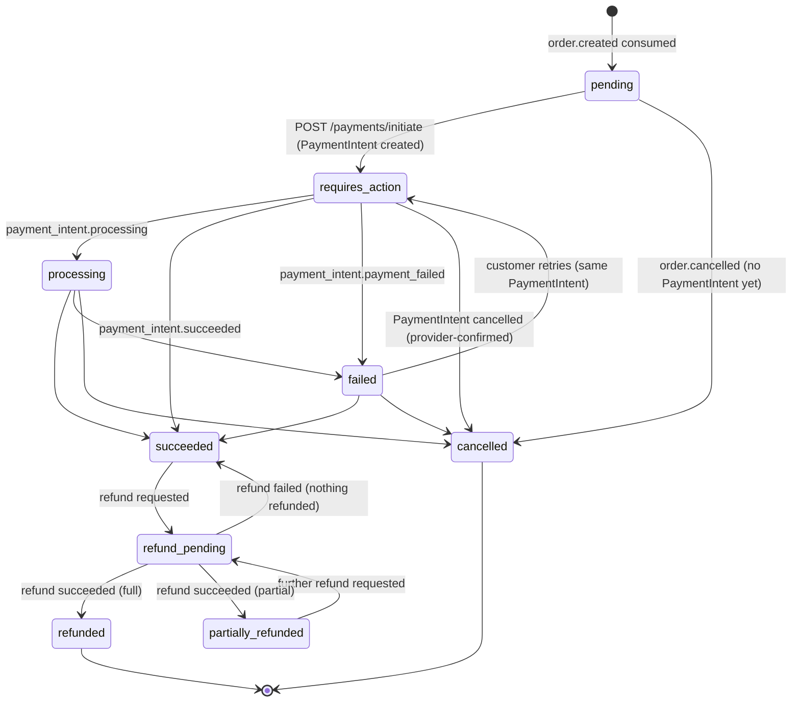

There are two transition tables, deliberately separate:

| Table | Driven by | Rule |
|---|---|---|
| `PAYMENT_TRANSITIONS` | PaymentIntent updates (webhooks, polling, initiation) and refund *requests* | **Captured states never change because of a PaymentIntent update**, so a delayed or replayed `payment_intent.*` webhook can never regress `succeeded`, `refund_pending`, `partially_refunded` or `refunded`. |
| `REFUND_OUTCOME_TRANSITIONS` | the provider's outcome for a refund **we created** (matched by refund id) | `refund_pending → refunded / partially_refunded / succeeded`, plus Stripe's *refund reversal* (a refund reported succeeded that later fails: `refunded → partially_refunded / succeeded`). |

*Found by the tests:* an early version kept both in one table, so a delayed `payment_intent.succeeded` moved a `refunded` payment back to `succeeded`. The split table plus `test/payment-status.test.ts` keep that from coming back.

- `refundStatus` (`none | pending | succeeded | failed`) records the latest refund outcome separately from the payment status, alongside `refundedAmount`.
- A retry after failure reuses **the same PaymentIntent**, so one order can never have two active charges.
- Every change is a **compare-and-set** on the current status, in a MongoDB transaction together with its outbox event.

### 13.4 Collections (`payment_db`)

| Collection | Purpose | Key constraints |
|---|---|---|
| `payments` | one per order | unique `orderId`; unique sparse `providerPaymentIntentId` |
| `refunds` | each refund attempt | unique `idempotencyKey`; unique sparse `providerRefundId` |
| `processed_events` | consumed RabbitMQ events and Stripe webhook ids (`processOnce`) | `_id = consumer:eventId` |
| `outbox_events` | payment events awaiting publication | |
| `mock_provider_objects` | **mock provider only**: simulated PaymentIntents and refunds | never used with Stripe |

No card data is stored, only Stripe ids, statuses, amounts and failure codes/messages. The PaymentIntent `client_secret` is not persisted; it's fetched from Stripe when it needs to be returned.

### 13.5 Provider abstraction

`PaymentProvider` has two implementations, selected by `PAYMENT_PROVIDER`:

- **`stripe`**: the official SDK. It requires `sk_test_…`/`rk_test_…` keys and **refuses live keys at startup**. Every mutating call carries an idempotency key derived from our own ids (`pi:<paymentId>`, `cancel:<paymentId>`, `refund:<refundId>`).
- **`mock`**: a local stand-in for development and tests. Records are labelled `provider: "mock"` and ids look like `pi_mock_…`. It delivers Stripe-shaped webhooks signed with Stripe's signature scheme, so the **same webhook verification path** runs for both. Mock payments are never presented as Stripe transactions.

### 13.6 Successful payment

```mermaid
sequenceDiagram
    autonumber
    actor C as Customer
    participant O as Order Service
    participant MQ as RabbitMQ
    participant P as Payment Service
    participant S as Stripe (test mode) / mock
    C->>O: POST /orders
    O->>O: txn: order + outbox(order.created)
    O-->>C: 201 pending_payment
    O->>MQ: order.created.v1
    MQ->>P: order.created.v1
    P->>P: txn: processOnce(eventId) + upsert payment (unique orderId) → pending
    C->>P: POST /payments/initiate {orderId}
    P->>O: GET /orders/:id (customer JWT): owner? pending_payment? total?
    P->>S: create PaymentIntent(amount from order, INR paise), Idempotency-Key pi:<paymentId>
    S-->>P: pi_… + client_secret
    P->>P: txn: pending → requires_action, store pi id
    P-->>C: 201 {clientSecret, paymentIntentId}
    C->>S: confirm card (Stripe.js / test card / mock simulate)
    S->>P: POST /payments/webhook payment_intent.succeeded (Stripe-Signature)
    P->>P: verify signature over raw body; txn: processOnce(evt id) + requires_action → succeeded + outbox(payment.succeeded)
    P-->>S: 200
    P->>MQ: payment.succeeded.v1
    MQ->>O: payment.succeeded.v1
    O->>O: txn: processOnce + pending_payment → confirmed, paymentStatus paid
```

### 13.7 Cancellation and refund

```mermaid
sequenceDiagram
    autonumber
    actor C as Customer
    participant O as Order Service
    participant MQ as RabbitMQ
    participant P as Payment Service
    participant R as Reconciler (in Payment Service)
    participant S as Stripe / mock
    C->>O: POST /orders/:id/cancel
    O->>O: txn: confirmed → cancelled, paymentStatus refund_pending + outbox(order.cancelled)
    O->>MQ: order.cancelled.v1
    MQ->>P: order.cancelled.v1
    P->>P: txn: processOnce + orderCancelledAt + refund record (key order-cancelled:<paymentId>) → refund_pending
    P->>R: kick
    R->>S: create refund (Idempotency-Key refund:<refundId>)
    S-->>R: re_… status pending
    S->>P: webhook refund.updated (succeeded)
    P->>P: txn: refund succeeded; refund_pending → refunded + outbox(payment.refund.completed)
    P->>MQ: payment.refund.completed.v1
    MQ->>O: payment.refund.completed.v1
    O->>O: paymentStatus refund_pending → refunded
```

**Refund and cancellation rules**

| Payment state when `order.cancelled` arrives | Action |
|---|---|
| *(applies to `order.cancelled` **and** `order.expired`)* | |
| no record yet (event order swapped) | create the payment already `cancelled`; a late `order.created` is a no-op |
| `pending` (no PaymentIntent) | → `cancelled` immediately, emit `payment.cancelled` |
| `requires_action` / `processing` / `failed` | reconciler cancels the PaymentIntent at the provider. If the provider says it already **succeeded** (race), the reconciler adopts that state and refunds. |
| `succeeded` / `partially_refunded` | one cancellation refund for the **remaining** amount |
| `refund_pending` (admin refund in flight) | reconciler refunds the remainder once that refund settles |
| `refunded` / `cancelled` | nothing |
| cancellation/expiry repeated, or both | ignored after the first (`orderCancelledAt` already set; one shared refund key) |

- **Success-versus-cancellation race:** if `payment_intent.succeeded` arrives after the order was cancelled, the payment becomes `succeeded` (it really was captured), `payment.succeeded` is published, and a refund is created in the **same transaction**. The Order Service never revives the order; it records `paymentStatus: refund_pending`.
- **Refund failures** (`refund.failed`, or a provider rejection) are recorded and published as `payment.refund.failed`. They are **not retried automatically**, since a closed card won't start working; a platform admin can issue a new refund with `POST /payments/:id/refund`.
- **Duplicate refunds are impossible:** cancellation refunds use the unique key `order-cancelled:<paymentId>`, admin refunds use the client's `Idempotency-Key`, and every provider call uses `refund:<refundId>`.

### 13.8 Error recovery

| Failure | Behaviour |
|---|---|
| RabbitMQ down | Webhooks and initiation keep working (the record is created from the Order Service REST response if `order.created` hasn't arrived). Payment events wait in `outbox_events` and are published when the broker returns. *Verified in E2E scenario 5.* | **Superseded (§16):** the REST fallback was removed; initiation answers `409 BILLING_PENDING` until `billing.finalized` arrives.
| Payment Service restarted | All state is in MongoDB (including the mock provider's intents); the consumer resumes from the durable queue; the same PaymentIntent is reused. *Verified.* |
| Stripe/provider unavailable | `initiate` → 503 `PAYMENT_PROVIDER_UNAVAILABLE` (retry is safe: same idempotency key). Reconciler work is retried with exponential backoff (1 s → 5 min). Every Stripe call has a **hard deadline**, because SDK v23 was observed to never settle a request to an unreachable host. |
| Webhook lost or late | The reconciler polls PaymentIntents stuck in `processing`, and refunds still `pending`, after `PROVIDER_POLL_AFTER_MS`. |
| Webhook duplicated / out of order | `processOnce(stripe event id)` plus the transition tables; stale events return 200 with `result: "stale"`. |
| Invalid event payload | `PermanentEventError` → straight to the DLQ (no retries). |
| Transient handler error (DB, write conflict) | Message not acked until commit; TTL retry queue (5 s, max 5), then DLQ. |
| Crash between a provider call and our write | The provider call is repeated with the same idempotency key, returning the same object. |

### 13.9 Stripe test-mode setup and local webhooks

The stack runs with the **mock provider by default**. To use real Stripe test mode:

1. In the Stripe Dashboard, switch to **Test mode** → Developers → API keys → copy the **secret key** (`sk_test_…`).
2. Install the Stripe CLI, run `stripe login`, then run `stripe listen --forward-to localhost:8080/payments/webhook`. It prints a webhook signing secret (`whsec_…`).
3. In `.env`, set `PAYMENT_PROVIDER=stripe`, `STRIPE_SECRET_KEY=sk_test_…` and `STRIPE_WEBHOOK_SECRET=whsec_…`, then run `docker compose up -d payment-service`.
4. Pay with test cards. Without a frontend, `POST /payments/:id/simulate` confirms the PaymentIntent with Stripe test PaymentMethods (`pm_card_visa`, `pm_card_chargeDeclined`, `pm_card_refundFail`). The result still arrives through the forwarded, signed webhook.

The service **refuses to start** with a live key, and the simulate endpoint exists only when `ENABLE_TEST_ENDPOINTS=true`.

INR note: Stripe requires a `description` for INR payments from Indian accounts (we send `Food order <orderNumber>`). Some account configurations need extra customer details for INR. That can only be checked with a real test account.

### 13.10 Limitations

- **Real Stripe test mode is not yet verified.** No credentials were available. The Stripe provider is unit-tested offline (signature verification, live-key refusal, hang protection) and validated against **stripe-mock**, Stripe's official API mock, which checks request shapes but is stateless and isn't Stripe.
- ~~Payment amount = the order's `provisionalTotal`~~: since Stage 5 the Payment Service charges only the Billing invoice's `finalAmount` (§15).
- No 3-D Secure / redirect flows (`allow_redirects: 'never'`); a frontend would add Stripe.js confirmation.
- Failed refunds need manual follow-up (by design), and there is no admin UI or alerting for them yet beyond logs, the `payment.refund.failed` event and `refundStatus: failed`.
- The mock provider delivers webhooks to the service itself over HTTP. If delivery keeps failing it gives up after 5 attempts, and the reconciler's polling covers `processing` intents and pending refunds.

---

## 14. Automatic expiration of unpaid orders

Every new order gets a payment deadline: `expiresAt = createdAt + ORDER_PAYMENT_DEADLINE_SECONDS` (default **900 s = 15 min**), included in `order.created.v1` as an optional field. Being "unpaid" is read from the existing mirrored `paymentStatus` (`pending` or `failed`); there is no separate `isPaid` flag.

### Expiration worker (Order Service)

`services/order/src/services/expiration.worker.ts` sweeps every `EXPIRY_SWEEP_INTERVAL_MS` (default 15 s), oldest first, in batches of `EXPIRY_BATCH_SIZE`:

```
txn {
  findOneAndUpdate({ _id, status: 'pending_payment', paymentStatus ∈ {pending, failed}, expiresAt ≤ now },
                   { status: 'expired', expiredAt: now, push statusHistory (by: expiration-worker, role: system) })
  if matched → enqueueEvent(order.expired.v1)        // transactional outbox
}
```

- **Atomic and exactly-once.** The compare-and-set and the outbox write commit together. Two replicas, or a restarted worker, can't expire an order twice or emit two events. *Tested with two racing workers and with a restart mid-backlog.*
- **Restart-safe.** The worker is stateless. After downtime it expires everything that fell due in the meantime. *Verified live by stopping `order-service` past the deadline.*
- **Never deletes.** `{ status: 1, expiresAt: 1 }` is an ordinary query index, **not a TTL index**. Expired orders and their payments remain for history and audit.
- `expired` is terminal: it can't be cancelled, transitioned or paid.

### Payment Service reaction

`order.expired.v1` is handled exactly like `order.cancelled.v1` (`onOrderClosed`, `orderClosure: "expired"`):

| Payment state | Result |
|---|---|
| `pending` (never initiated) | → `cancelled`, `payment.cancelled` |
| open PaymentIntent | reconciler cancels it at Stripe/mock → `cancelled`, `payment.cancelled` |
| captured (late success) | one automatic refund (`requestedBy: system:order-expired`) → `payment.refund.completed` |

Initiation is refused with **409 `ORDER_EXPIRED`** when the order is expired, when the payment record is closed by expiry, or when `expiresAt` has simply passed and the sweep hasn't run yet. That last check closes the gap of up to one sweep interval.

### Races

| Race | Outcome |
|---|---|
| `payment.succeeded` applied before the sweep | worker filter no longer matches → order stays `confirmed`, no `order.expired` |
| sweep commits first, success webhook later (delayed webhook) | order stays `expired`, `paymentStatus: refund_pending`; the Payment Service refunds (cancel attempt finds the intent succeeded, or the success arrives with the order already closed) → `refunded` |
| both at once | MongoDB write conflict / compare-and-set: exactly one wins; the loser retries immediately with fresh state. Never both "confirmed" and "expired". *Tested with 8 concurrent pairs (order side) and 6 concurrent card-completion/expiry pairs (payment side).* |

*Found while testing this:* the mock provider's PaymentIntent updates were read-modify-write, so a concurrent cancel and confirm could both "succeed". The mock now uses atomic compare-and-set (as Stripe does), and the workflow logs any "charge on a cancelled payment" as an error-level anomaly for manual follow-up.

---

## 15. Billing (Stage 5)

> Historical design record. The event is now `billing.finalized.v1` and issue-on-demand over REST is removed (§16.6).

### 15.1 Design and changes required

| # | Change | Why |
|---|---|---|
| B1 | New **Billing Service** (`:4005`, `billing_db`) issues **one immutable invoice per order** from `order.created.v1` | Billing becomes the authoritative source of the payable amount |
| B2 | `finalAmount = subtotal − discountAmount + taxAmount`, with **`taxAmount = 0`** for now. `subtotal = itemsSubtotal + deliveryFee`: the delivery fee is an invoice line, so it isn't lost | Matches the requested formula without silently dropping the ₹40 fee the order already charges |
| B3 | **Payment Service charges only `invoice.finalAmount`.** The payment record's amount is unset until the invoice is known (`billing.invoice_generated.v1`, or Billing REST on demand); initiation before that returns `409 INVOICE_NOT_READY` | No more charging the order's provisional total | **Superseded (§16.6):** only the event; before it, `409 BILLING_PENDING`.
| B4 | **Issue-on-demand:** `POST /invoices/order/:orderId/issue` (customer JWT forwarded) builds the invoice from the Order Service's REST view if the event hasn't been processed yet. It is idempotent: unique `orderId` | Delayed or lost billing events (or a broker outage) don't block payment | **Removed in §16** (no synchronous fallback).
| B5 | Orders accept an optional **`discountCode`**, carried on `order.created.v1` (optional field). **Billing** validates it; an invalid code issues the invoice without a discount and records why | Discounts are a billing concern; the Order Service doesn't interpret codes |
| B6 | **Subtotal verification:** Billing recomputes every `lineTotal = unitPrice × quantity`, `Σ lines = subtotal` and `subtotal + deliveryFee = provisionalTotal`. On a mismatch → `PermanentEventError` (DLQ) and no invoice, so the order can't be paid and expires | Billing never trusts arithmetic it didn't do |
| B7 | **Immutability:** invoices and billing entries reject every update/delete at the model layer. Payments, refunds, refund reversals and voids (cancellation/expiry) are **append-only billing entries** keyed by `orderId` (unique per `(kind, reference)`); the invoice's status is *derived* | Audit trail; arrival order doesn't matter |
| B8 | Order Service consumes `billing.invoice_generated.v1` and mirrors `billing { invoiceId, invoiceNumber, discountCode, discountAmount, taxAmount, finalAmount }`; `payment.succeeded` must equal `billing.finalAmount` | The paid amount is verified against the invoice, not the provisional total |
| B9 | Tax extensibility: invoices carry `taxLines: [{ name, rate, base, amount }]` (empty today), `taxAmount = Σ taxLines`, plus `schemaVersion` | Taxes can be added later without a redesign |

### 15.2 Invoice calculation

```
lines          = one line per item (unitPrice × quantity, verified) + a "Delivery fee" line when > 0
itemsSubtotal  = Σ item lines                                  (must equal the order's subtotal)
subtotal       = itemsSubtotal + deliveryFee                   (must equal the order's provisionalTotal)
discountAmount = discount evaluated on itemsSubtotal, capped so finalAmount ≥ MIN_PAYABLE_AMOUNT (₹1)
taxLines       = []            taxAmount = Σ taxLines = 0       (reserved, see B9)
finalAmount    = subtotal − discountAmount + taxAmount          ← the ONLY amount that may be charged
```

Discount codes (`discounts` collection; seeded: `WELCOME50` ₹50 off ≥ ₹199, `FEAST20` 20% up to ₹150 off ≥ ₹499,
`FLAT100` ₹100 off ≥ ₹799, plus the expired `MONSOON15` and paused `PAUSED25` for demos) are mutable configuration.
The invoice **snapshots** the discount it used, so editing or deactivating a code never changes issued invoices.
A rejected code is recorded on the invoice (`discountRejection: { code, reason }`, e.g. `EXPIRED`,
`MIN_SUBTOTAL_NOT_MET`), and the order is invoiced at full price.

### 15.3 Ledger and derived status

The invoice never changes. Everything that happens afterwards is an immutable `billing_entries` row, unique per `(kind, reference)`:

| Entry | From | Reference |
|---|---|---|
| `payment` (+amount; flagged `anomaly` if ≠ invoice) | `payment.succeeded.v1` | paymentId |
| `refund` (credit note `CN-…`) | `payment.refund.completed.v1` | refundId |
| `refund_reversal` | `payment.refund.failed.v1` for a refund already credited | refundId |
| `closure` (voids if unpaid) | `order.cancelled.v1` or `order.expired.v1` (whichever first) | orderId |

`status` is derived: `open` (nothing paid, not closed), `void` (closed before payment), `paid`, `partially_refunded`
or `refunded`. The API also returns `amountPaid`, `amountRefunded`, `netCollected` and `amountDue`. Entries are keyed by
`orderId`, so the arrival order doesn't matter: a closure that arrives before `order.created` still voids the invoice issued later.

### 15.4 Flow

```mermaid
sequenceDiagram
    autonumber
    actor C as Customer
    participant O as Order Service
    participant MQ as RabbitMQ
    participant B as Billing Service
    participant P as Payment Service
    C->>O: POST /orders {items, discountCode?}
    O->>MQ: order.created.v1 (via outbox)
    MQ->>B: order.created.v1
    B->>B: verify totals, evaluate discount, txn: invoice (unique orderId) + outbox(billing.invoice_generated)
    B->>MQ: billing.invoice_generated.v1 {finalAmount}
    MQ->>P: invoice → payment.amount = finalAmount
    MQ->>O: invoice → order.billing mirror
    C->>P: POST /payments/initiate
    alt invoice not received yet (delayed events / broker down)
        P->>B: POST /invoices/order/:id/issue (customer JWT)
        B->>O: GET /orders/:id
        B-->>P: invoice (issued now, or the existing one)
    end
    P->>P: PaymentIntent for finalAmount (never the provisional total)
    Note over P,O: payment.succeeded {amount = finalAmount, invoiceId} → Order verifies against its mirror,<br/>Billing records a payment entry; refunds/cancellation/expiry become ledger entries
```

### 15.5 Failure handling

| Situation | Behaviour |
|---|---|
| `order.created` redelivered / sent twice | unique `orderId`: one invoice, one `invoice_generated` event |
| Billing event delayed or the broker is down | payment initiation issues the invoice on demand over REST (idempotent; races with the event resolve to one invoice). *Verified live with RabbitMQ stopped.* | **Superseded (§16.6):** now `409 BILLING_PENDING` until recovery.
| Billing Service down | `POST /payments/initiate` → 503 and **nothing is charged**. Queued `order.created` events are processed on restart. *Verified live.* | **Now:** `409 BILLING_PENDING` (Payment no longer calls Billing). *Re-verified live.*
| Totals don't add up | no invoice (`PermanentEventError` → DLQ; REST → 422). The order can't be paid and expires after 15 min |
| Invoice event arrives before `order.created` (Payment Service) | the payment record is created with the invoice amount; the later `order.created` is a no-op |
| A second, different invoice for an order | rejected as permanent (Payment and Order) |
| Payment and refund events duplicated | ledger uniqueness `(kind, reference)`: no double counting, even with new event ids. *Verified live.* |
| Cancellation **and** expiry | one `closure` entry |
| Order expiry (15-minute mechanism) | unchanged; billing voids the invoice and payment refuses `ORDER_EXPIRED` |

---

## 16. Final communication architecture (event-driven choreography)

### 16.1 Rules

| Interaction | Mechanism |
|---|---|
| Client ↔ system | REST through the API gateway; JWT + role checks in each client-facing service |
| Service ↔ service | **RabbitMQ events only** (topic exchange `food.events`, a durable queue per consumer, transactional outbox on the publishing side). No internal HTTP for business workflows; no request/response over RabbitMQ |
| Data ownership | each service writes only its own database; other services keep **local read models** fed by events |
| Order lifecycle | **only the Order Service** changes order status and history. Other services publish facts (`payment.*`, `billing.*`, `delivery.*`); the Order Service validates each transition and then publishes the customer-facing result |

### 16.2 Internal HTTP audit (before → after)

| # | Before (synchronous) | After (Stage 6-prep refactor) |
|---|---|---|
| 1 | Order → Catalog `GET /restaurants/:id/menu` (validate prices/availability) | **Removed.** The Order Service validates against its local **catalog read model** (§16.5) |
| 2 | Order → Catalog `GET /restaurants/:id` (restaurant-admin ownership) | **Removed.** Same read model (`ownerId`; since Stage 8.2 `adminIds`) |
| 3 | Payment → Billing `POST /invoices/order/:id/issue` (issue on demand) | **Removed.** Payment consumes `billing.finalized.v1`; before that, initiation answers **`409 BILLING_PENDING`** (`Retry-After`) |
| 4 | Billing → Order `GET /orders/:id` (used only by #3) | **Removed**, with the issue-on-demand endpoint |
| 5 | Payment → Order `GET /orders/:id` (owner, payable status, deadline) | **Removed.** `customerId` and `expiresAt` come from `order.created` / `billing.finalized` and never change; cancellation and expiry arrive as events. A payment racing a not-yet-consumed cancellation is refunded automatically (§13.7) |

Remaining HTTP: client → gateway → services, and the mock payment provider's webhook delivery (it stands in for Stripe, an external system). **No internal service-to-service HTTP remains.**

### 16.3 Event matrix

Every event uses the common envelope `{ eventId, eventType, version, occurredAt, source, correlationId?, data }`; the outbox row also records `aggregateId`.
Routing key = `<eventType>.v<version>`. Consumers deduplicate by `eventId` (`processOnce`) and/or by a business key or version, as listed in §7.2, so redelivered events are harmless,
and so are *distinct* events that describe the same fact.

| Event | Publisher | Consumers | Purpose / business key | Notes |
|---|---|---|---|---|
| `auth.user.deleted.v1` | Auth | Catalog, Delivery | An inactive account was permanently deleted: `userId`, `role`, `deletedAt`. Key: `userId` (ids are never reused) | Outbox, same transaction as the delete; never published when nothing was deleted; Catalog removes **all** assignments and tombstones the id, Delivery blocks the agent permanently (§23) |
| `auth.user.deactivated.v1` | Auth | Catalog, Delivery | An active account was deactivated: `userId`, `role`, `deactivatedAt`, `deactivatedBy`. Key: `userId` + `deactivatedAt` | Outbox, same transaction as the status change; never published for an already-inactive account; Catalog removes only assignments made before `deactivatedAt` (§20.3) |
| `catalog.restaurant.updated.v2` | Catalog | Order | Full restaurant + menu snapshot incl. `adminIds` (v1 with `ownerId` retired) (event-carried state transfer). Key: `restaurantId` + monotonic `catalogVersion` | Published on every change (same transaction as the change) and in periodic/requested snapshots; only newer versions are applied |
| `catalog.sync_requested.v1` | Order | Catalog | Asks the Catalog to re-broadcast snapshots (bootstrap or repair). Fire-and-forget; answered by ordinary `catalog.restaurant.updated` broadcasts | Not request/response: no reply queue, any consumer benefits |
| `order.created.v1` | Order | Payment, Billing | The order's financial snapshot, `expiresAt`, `discountCode`. Key: `orderId` | unchanged |
| `order.confirmed.v1` | Order | Delivery | The order was paid and confirmed (+ `customerEmail`, `customerName` since Stage 6). Key: `orderId` | starts the delivery |
| `order.cancelled.v1` | Order | Payment, Billing, Delivery | Cancellation (refund/void, stop the delivery). Key: `orderId` | Delivery leaves a tombstone if the confirmation hasn't arrived yet |
| `order.expired.v1` | Order | Payment, Billing, Delivery | Unpaid at the deadline. Key: `orderId` | 〃 |
| `order.status_changed.v1` | Order | **Notification** (its queue binds `order.#` and ignores the other order events) | **Customer-facing projection** of every accepted status transition: email, status, previousStatus, `sequence`, order summary. Key: `orderId` + `sequence` | **new**; the *only* event Notification turns into emails, so specific and general events never produce two emails |
| `billing.finalized.v1` | Billing | Payment, Order | The authoritative payable amount: `finalAmount`, currency, `invoiceVersion`, ids, `expiresAt`. Key: `orderId` (one invoice per order) | **renamed** from `billing.invoice_generated.v1`; consumers still accept the old key during the transition |
| `payment.succeeded.v1` / `payment.failed.v1` / `payment.cancelled.v1` / `payment.refund.completed.v1` / `payment.refund.failed.v1` | Payment | Order (+ Billing for `succeeded`, `refund.completed`, `refund.failed`) | Payment outcomes. Key: `paymentId` / `refundId` | unchanged |
| `delivery.ready_for_pickup.v1` | Delivery | Order | confirmed → `assigning_delivery_partner` | implemented |
| `delivery.partner_assigned.v1` | Delivery | Order | → `partner_assigned` (agent display name) | 〃 |
| `delivery.picked_up.v1` | Delivery | Order | → `out_for_delivery` | 〃 |
| `delivery.location_reached.v1` | Delivery | Order | → `location_reached` | 〃 (contains **no OTP**) |
| `delivery.completed.v1` | Delivery | Order | → `delivered` (only after OTP verification) | 〃 |
| `notification.delivery_otp.v1` | Delivery | Notification only | Sends the OTP to the customer | **restricted**, see §16.7 |
| `delivery.cancelled.v1` | Delivery | Order (mirror only) | Delivery stopped because the order was cancelled; partner released | Stage 6 |
| `delivery.assignment_failed.v1` | Delivery | Order (mirror only) | No partner within the bounded retries; operator action needed (no automatic refund) | Stage 6 |

Removed, never-published placeholders: `delivery.assigned`, `delivery.out_for_delivery` (replaced by the contracts above).

### 16.4 Order lifecycle (authoritative, customer-visible)

```
pending_payment ─payment.succeeded─► confirmed ─delivery.ready_for_pickup─► assigning_delivery_partner
  │   │                                 │ │            ─delivery.partner_assigned─► partner_assigned
  │   └─(deadline)─► expired            │ └─cancel─► cancelled  ─delivery.picked_up─► out_for_delivery
  └──────cancel───► cancelled           │                ─delivery.location_reached─► location_reached
                                        └──────────────────── ─delivery.completed─► delivered
```

Status values stay lower-case snake case (backward compatible): `confirmed` = ORDER_CONFIRMED, `assigning_delivery_partner`,
`partner_assigned`, `out_for_delivery`, `location_reached`, `delivered`. `preparing`, `ready_for_pickup` and `payment_failed` are
retained only for historical documents. The interim manual `PATCH /orders/:id/status` (restaurant/agent/admin) is
**removed**: delivery progress comes only from Delivery events (Stage 6 gives agents their own authenticated REST API in the Delivery Service).

Each `statusHistory` entry: `{ status, at, sourceEventId, sourceService, by, role, note?, metadata? }`. It is appended in the
same update that sets the `status` projection (one atomic compare-and-set), and in the same transaction that writes the
outbox events. The last element is always the current status. `GET /orders/:id/tracking` exposes it for a progress tracker.

Delivery events are applied with **rank ordering**: an event whose predecessor state hasn't been reached yet is retried
(it arrived early); an event at or behind the current state is ignored (duplicate or stale); a cancelled/expired order ignores delivery progress.

### 16.5 Catalog read model in the Order Service

- **Authority:** the Catalog Service. The Order Service's `catalog_restaurants` collection is a disposable projection.
- **Publication:** every catalog mutation bumps `catalogVersion` on the restaurant and writes a `catalog.restaurant.updated.v2`
  snapshot of the restaurant and its whole menu to the outbox, **in the same transaction**. One aggregate per event means no
  partial-menu ordering problems.
- **Bootstrap and repair:** the Catalog re-broadcasts all restaurants at startup, every `CATALOG_SNAPSHOT_INTERVAL_MS`
  (default 5 min, anti-entropy), and when it receives `catalog.sync_requested.v1`. The Order Service sends that request at
  startup while its projection is empty.
- **Ordering and duplicates:** the projection applies a snapshot only if `catalogVersion` is newer (compare-and-set on the stored version).
- **Staleness policy:** order placement returns **503 `CATALOG_SYNC_PENDING`** until the projection is bootstrapped, and
  **503 `CATALOG_SYNC_UNAVAILABLE`** while the Order Service's broker connection is down, because changes could be in flight.
  A restaurant or item missing from the projection is treated as unknown (422), exactly as before. Residual window: consumer
  lag after a change (milliseconds normally); the order snapshot records the `catalogVersion` it was priced from.

### 16.6 Billing → Payment without HTTP

`order.created` → Billing → `billing.finalized.v1 { finalAmount, invoiceVersion, expiresAt, … }` → the Payment Service stores the amount.
`POST /payments/initiate` before that → **`409 BILLING_PENDING`** with `Retry-After: 2`; the client retries. No amount that Billing
hasn't finalized can ever be charged. During a broker outage, new orders can't be paid (or, see §16.5, placed) until
recovery, which is the explicit pending state. Unpaid orders still expire after 15 minutes.

### 16.7 Delivery OTP (implemented in Stage 6, details in §18.5)

- The Delivery Service generates the OTP and stores **only a hash** (with expiry and attempt counter).
- It publishes `notification.delivery_otp.v1` to a **separate exchange `food.restricted`** (direct), bound only to
  `notification-service.delivery-otp`. With per-service RabbitMQ users (§16.8), only `delivery-service` may write to it and only `notification-service` may read from it.
- Defence in depth: the payload carries `otpCiphertext`, the OTP sealed with the Notification Service's public key (X25519 sealed box), so even a misrouted copy is unreadable.
- The Notification Service decrypts in memory, renders the email, and **never persists or logs the OTP**. Its notification record keeps the sealed box only until the email is sent or abandoned; the rendered body is not stored.
- The OTP never appears in `delivery.*`, `order.*`, the order history or the logs.

### 16.8 RabbitMQ topology and per-service permissions (implemented in Stage 6)

One broker, one vhost, exchange `food.events` (topic), plus `food.restricted` (direct, Stage 6). Queues (each with `.retry` and `.dlq`):

| Queue | Bindings |
|---|---|
| `order-service.payment-events` | `payment.succeeded/failed/cancelled.v1`, `payment.refund.completed/failed.v1` |
| `order-service.billing-events` | `billing.finalized.v1` (+ legacy `billing.invoice_generated.v1`) |
| `order-service.catalog-events` | `catalog.restaurant.updated.v2` (v1 binding removed at startup) |
| `order-service.delivery-events` | `delivery.ready_for_pickup/partner_assigned/picked_up/location_reached/completed.v1` |
| `catalog-service.sync-requests` | `catalog.sync_requested.v1` |
| `catalog-service.auth-events` | `auth.user.deactivated.v1`, `auth.user.deleted.v1` |
| `delivery-service.auth-events` | `auth.user.deactivated.v1`, `auth.user.deleted.v1` |
| `auth-service.delivery-events` | `delivery.partner_assigned/completed/cancelled.v1` |
| `payment-service.order-events` | `order.created/cancelled/expired.v1` |
| `payment-service.billing-events` | `billing.finalized.v1` (+ legacy) |
| `billing-service.events` | `order.created/cancelled/expired.v1`, `payment.succeeded.v1`, `payment.refund.completed/failed.v1` |
| `notification-service.order-events` | `order.#` (only `order.status_changed.v1` produces email) |
| `notification-service.delivery-otp` | **`food.restricted`** ← `notification.delivery_otp.v1` (the only binding on that exchange) |
| `delivery-service.order-events` | `order.confirmed/cancelled/expired.v1` |

Each consumer also owns `<queue>.parking` (direct exchange) for its retry/DLQ routing; queues dead-letter through it rather
than the default exchange.

**Per-service users (implemented).** The one-shot `rabbitmq-setup` container (`infra/rabbitmq-setup/setup.mjs`) runs on every
`docker compose up` before the services start. Using the bootstrap admin (which no service uses), it creates one user per service with a
password from `.env` (`RABBITMQ_<SERVICE>_PASSWORD`, generated by `node scripts/init-env.mjs`), pre-declares both exchanges, and
sets least-privilege permissions (`S` = the service's own prefix, e.g. `order-service\..*`):

| User | configure | write | read | topic write on `food.events` |
|---|---|---|---|---|
| `auth-service` | `food.events`, `S` | `food.events`, `S` | `food.events`, `S` | `^auth\.` (publishes only; no queues) |
| `catalog-service` | `food.events`, `S` | `food.events`, `S` | `food.events`, `S` | `^catalog\.restaurant\.` |
| `order-service` | `food.events`, `S` | `food.events`, `S` | `food.events`, `S` | `^(order\|catalog\.sync_requested)\.` |
| `payment-service` | `food.events`, `S` | `food.events`, `S` | `food.events`, `S` | `^payment\.` |
| `billing-service` | `food.events`, `S` | `food.events`, `S` | `food.events`, `S` | `^billing\.` |
| `delivery-service` | `food.events`, `S` | `food.events`, **`food.restricted`**, `S` | `food.events`, `S` | `^delivery\.` |
| `notification-service` | `food.events`, `S` | `food.events`, `S` | `food.events`, **`food.restricted`**, `S` | `^$` (publishes nothing) |

What this enforces (each verified live by `scripts/e2e-delivery.mjs` with the real per-service credentials):
- only `delivery-service` can publish to `food.restricted`; only `notification-service` can bind/consume there (reading needs *read* on the exchange);
- the publisher itself cannot read the OTP queue;
- **no service can write to the default exchange**, so no service can inject messages into another service's queue
  (RabbitMQ also checks this permission for a queue's dead-letter exchange, hence the parking exchanges);
- topic permissions stop one service from forging another's events (e.g. Payment cannot publish `delivery.completed`).

Migration: queues created before Stage 6 dead-lettered through the default exchange; `rabbitmq-setup` deletes such queues **only if
empty** (their service recreates them) and refuses to continue otherwise. The admin user stays for the management UI, provisioning and tests.
The broker is never exposed publicly (management UI only on localhost in development).

### 16.9 Sequence: order → payment → confirmation → email

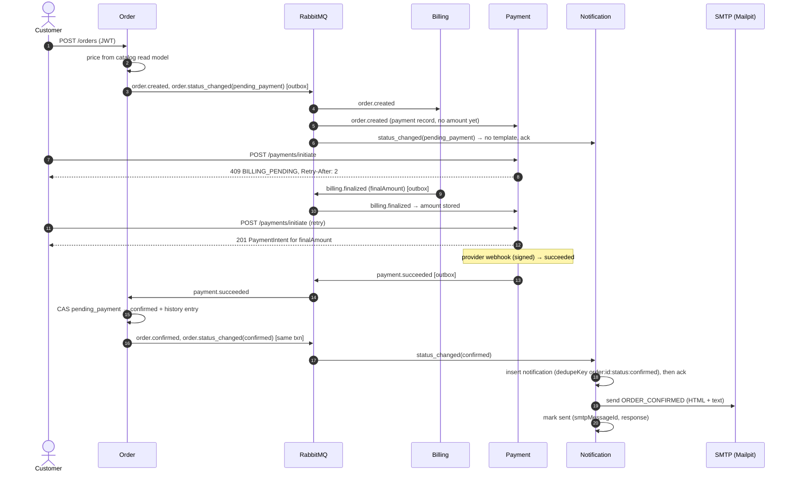

### 16.10 Sequence: delivery facts (Stage 6 publisher) → order status → emails

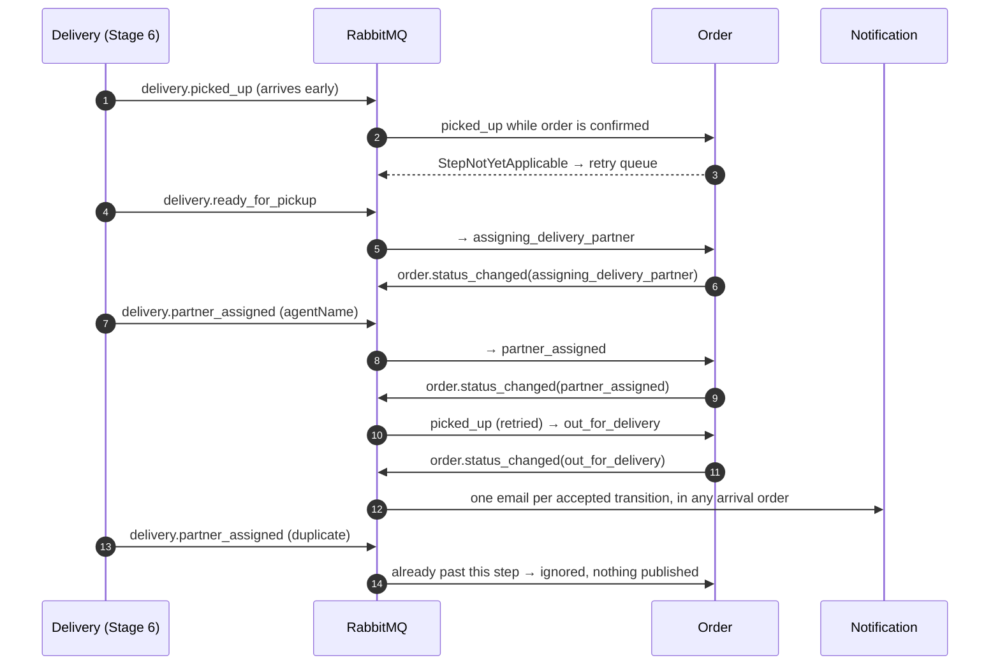

---

## 17. Notification Service

Internal only: it has **no gateway route and no published port**. It exposes only `/health` (inside the
Docker network) and talks to the rest of the system through RabbitMQ.

### 17.1 What triggers an email

The queue `notification-service.order-events` is bound to `order.#`, but **only `order.status_changed.v1`
produces email**; other order events are acknowledged and ignored. Because the Order Service publishes
`status_changed` only *after* it has accepted a transition, a rejected transition (illegal step, duplicate, closed
order) never sends an email, and a domain event plus `status_changed` describing the same transition never sends two.

| Order status | Template | Email |
|---|---|---|
| `pending_payment` | (none) | none (an unpaid order is not yet an order the customer must hear about) |
| `confirmed` | `ORDER_CONFIRMED` | order confirmed **and** payment received (one email: confirmation happens exactly when payment is verified) |
| `cancelled` | `ORDER_CANCELLED` | reason; "not charged" or "refund is automatic" depending on the previous status |
| `expired` | `ORDER_EXPIRED` | payment not completed in time, not charged |
| `assigning_delivery_partner` | `DELIVERY_ASSIGNING` | food is ready, assigning a partner |
| `partner_assigned` | `DELIVERY_PARTNER_ASSIGNED` | partner's display name |
| `out_for_delivery` | `OUT_FOR_DELIVERY` | partner name (carried forward by the Order Service) |
| `location_reached` | `AGENT_ARRIVED` | partner has arrived; the OTP comes in a separate restricted message (Stage 6) |
| `delivered` | `ORDER_DELIVERED` | delivered, item summary |

Every template has an HTML and a plain-text part. All dynamic values are HTML-escaped and amounts are formatted from paise as INR.

### 17.2 Processing model

```
order.status_changed.v1 ──► validate (zod) ──malformed──► PermanentEventError ──► DLQ (no record, no email)
        │
        ▼
insert notifications{ dedupeKey: "order:<id>:status:<status>", sourceEventId, template, context, status: pending }
        │  E11000 duplicate key → "duplicate" (redelivery, or another event for the same transition)
        ▼
ack the message ──► Sender (kicked immediately + polls every SENDER_INTERVAL_MS)
        │
        ▼
claim: pending & due (or sending with an expired lease) → status sending, attempts+1, leaseUntil
        │
        ├─ SMTP 250 ─────────► sent (sentAt, smtpMessageId, smtpResponse)
        ├─ transient error ──► pending, nextAttemptAt = now + min(2^attempts s, 10 min), failures[] += error
        ├─ SMTP 5xx ─────────► failed (permanent)
        └─ attempts = NOTIFY_MAX_ATTEMPTS (8) ► failed
```

- **Ack only after durable processing:** the RabbitMQ message is acknowledged only after the notification record is
  committed. If MongoDB is unavailable the handler throws and the broker's retry queue / DLQ take over.
- **SMTP is decoupled from the queue:** an SMTP outage leaves records `pending` with backoff; the queue keeps
  draining and the Order Service is never affected (notification failures never block orders).
- **Idempotency:** one record per (order, status) via the unique `dedupeKey`, which covers duplicate deliveries
  *and* distinct events describing the same transition. A `sent` record is never sent again.
- **Crash safety:** an attempt claimed by a process that dies keeps its lease (`SEND_LEASE_MS`, 60 s); after it expires,
  any instance retries it.
- **Records** (`notification_db.notifications`): id, `sourceEventId`, `eventType`, `orderId`, `customerId`, `recipient`,
  `template`, non-sensitive render `context`, `status`, `attempts`, `maxAttempts`, `nextAttemptAt`, `leaseUntil`,
  `lastError`, `failures[]` (last 10), `smtpMessageId`, `smtpResponse`, `sentAt`, `createdAt`, `updatedAt`. Rendered bodies are
  not stored (they are re-rendered per attempt), so a future OTP template never puts secrets at rest.

### 17.3 Known duplicate risk (documented, accepted)

SMTP acceptance and the MongoDB "sent" update **cannot be atomic**. If the process dies after the SMTP server accepted the
message but before the record is marked `sent`, the lease expires and the email is sent again (at-least-once). The
`Message-ID` (`<notificationId@notifications.food.local>`) is stable across attempts, so receiving systems and support staff
can recognise the duplicate. The window is the few milliseconds between SMTP `250` and the update.

### 17.4 SMTP configuration

`SMTP_HOST`, `SMTP_PORT`, `SMTP_SECURE`, `SMTP_USER`, `SMTP_PASSWORD`, `SMTP_TIMEOUT_MS`, `MAIL_FROM`. Locally these default to
**Mailpit** (`mailpit:1025`, UI and API at http://localhost:8025), which captures every message: **nothing reaches a real mailbox**.
**Mailpit is retained as the email backend for the final academic demonstration.** It captures mail, so fictional addresses work and delivery codes can be
read in its inbox. That inbox is shared and unauthenticated, so it must stay private and be restricted to project members ([DEPLOYMENT_GUIDE §11](DEPLOYMENT_GUIDE.md#11-mailpit-email-in-the-final-project)).
Switching to a real SMTP provider later would only need these variables, with credentials from secrets and never from the repo. That switch is untested.
Health: `mongo` is critical (503); `rabbitmq` and `smtp` (probed with `verify()` every 15 s) are optional (`degraded`).


---

## 18. Delivery Service (Stage 6)

Owns delivery operations: one delivery per confirmed order, simulated restaurant preparation, a pool of delivery
partners, random atomic assignment, the partner's pickup/arrival/OTP REST API, and the OTP itself. It never touches
another service's database; it learns about orders only from `order.*` events and reports only `delivery.*` facts.
The Order Service stays the authority over the customer-visible lifecycle.

### 18.1 Data (`delivery_db`)

| Collection | Contents | Integrity |
|---|---|---|
| `deliveries` | order/customer/restaurant snapshot (customer email only for addressing the OTP; never returned by the API), address, items, `status`, persisted deadlines `prepareReadyAt`, `nextAssignAt`, `assignmentDeadline`, `assignmentAttempts`, partner public details, milestone timestamps, cancellation, `otpIssues`, history | unique `orderId` (also tombstones for orders cancelled/expired before confirmation) |
| `delivery_agents` | `_id` = Auth user id, name, email, phone, `status` (available/busy/offline), `activeDeliveryId`, counters | unique partial index on `activeDeliveryId`: one partner per delivery, enforced by the database |
| `delivery_otps` | `deliveryId`, `sequence`, keyed `verifier` (HMAC-SHA256; `select: false`), `status` (active/consumed/superseded/expired/locked/cancelled), `attempts`/`maxAttempts`, `issuedAt`/`expiresAt`, outbox id of the OTP command | unique `(deliveryId, sequence)`; unique partial `deliveryId` where `status = active` |
| `account_blocks` | `_id` = Auth user id, `disabledAt`, `reenabledAt`, `deletedAt` (from Auth events, §23) | blocked agents are skipped by assignment and cannot go available |
| `processed_events`, `outbox_events` | idempotent consumption, transactional outbox | shared `@food/common` mechanisms |

### 18.2 State machines

Delivery Service (its own records):

```mermaid
stateDiagram-v2
    [*] --> preparing: order.confirmed (paid)
    preparing --> awaiting_partner: prepareReadyAt passed → delivery.ready_for_pickup
    awaiting_partner --> partner_assigned: random available partner reserved → delivery.partner_assigned
    awaiting_partner --> awaiting_partner: nobody free (retry after ASSIGNMENT_RETRY_MS)
    awaiting_partner --> assignment_failed: attempts/timeout exhausted → delivery.assignment_failed
    assignment_failed --> awaiting_partner: operator POST /deliveries/:id/retry-assignment
    partner_assigned --> picked_up: partner POST /pickup → delivery.picked_up
    picked_up --> arrived: partner POST /arrived → delivery.location_reached + OTP command
    arrived --> delivered: partner POST /verify-otp (correct code) → delivery.completed
    preparing --> cancelled: order.cancelled
    awaiting_partner --> cancelled: order.cancelled
    partner_assigned --> cancelled: order.cancelled (partner released)
    picked_up --> cancelled: order.cancelled (race only; partner returns the order)
    arrived --> cancelled: order.cancelled (race only; OTP invalidated)
    assignment_failed --> cancelled: order.cancelled
    delivered --> [*]
    cancelled --> [*]
```

Order Service (authoritative, customer-visible; full machine incl. payment states in §8):

| Order status | Entered on | Delivery mirror (`order.delivery.status`) | Email |
|---|---|---|---|
| `pending_payment` | placement | — | — |
| `confirmed` (ORDER_CONFIRMED) | `payment.succeeded` | `preparing` (implied) | order confirmed + payment received |
| `assigning_delivery_partner` | `delivery.ready_for_pickup` | `awaiting_partner` (or `assignment_failed` without a status change) | partner being assigned |
| `partner_assigned` | `delivery.partner_assigned` | `partner_assigned` + partner name and masked phone | partner assigned |
| `out_for_delivery` | `delivery.picked_up` | `picked_up` | out for delivery |
| `location_reached` | `delivery.location_reached` | `arrived` + code expiry time | partner arrived (+ separate restricted OTP email) |
| `delivered` | `delivery.completed` (`otpVerified: true` required) | `delivered` | delivered |
| `cancelled` / `expired` | cancel API / expiry worker | `cancelled` (from `delivery.cancelled`) | cancelled / expired |

Transition rules in the Order Service: only the *next* step is applied; an early event is retried (its predecessor is in
flight), a stale or duplicate one is ignored, a closed (cancelled/expired) order ignores delivery facts, a fact about a
**different `deliveryId`** than the order's delivery is rejected (dead-lettered), and `delivery.completed` without
`otpVerified: true` is rejected. Status, history entry, delivery mirror and the outgoing `order.status_changed` commit atomically.

### 18.3 Sequence: order confirmation → partner assignment

```mermaid
sequenceDiagram
    autonumber
    participant P as Payment
    participant O as Order
    participant MQ as RabbitMQ (food.events)
    participant D as Delivery
    participant W as Delivery scheduler
    participant N as Notification

    P->>MQ: payment.succeeded
    MQ->>O: payment.succeeded
    O->>MQ: order.confirmed (+ customer email/name), order.status_changed(confirmed)
    MQ->>N: status_changed → "order confirmed" email
    MQ->>D: order.confirmed
    D->>D: validate (paid, has email) · processOnce · insert delivery (unique orderId), prepareReadyAt = now + PREPARATION_DELAY_MS
    Note over W: every WORKER_INTERVAL_MS: due work read from MongoDB (survives restarts)
    W->>D: preparing → awaiting_partner (CAS) + outbox delivery.ready_for_pickup
    D->>MQ: delivery.ready_for_pickup
    MQ->>O: → assigning_delivery_partner + status_changed
    MQ->>N: "assigning a partner" email
    W->>D: $sample available partners · in ONE transaction: CAS partner available→busy (activeDeliveryId) + CAS delivery awaiting_partner→partner_assigned + outbox
    alt nobody available
        W->>D: attempts+1, nextAssignAt = now + ASSIGNMENT_RETRY_MS (bounded; then delivery.assignment_failed)
    end
    D->>MQ: delivery.partner_assigned (name, masked phone)
    MQ->>O: → partner_assigned (public partner details in history + mirror)
    MQ->>N: "Ravi Kumar will deliver" email
```

### 18.4 Sequence: pickup → arrival

```mermaid
sequenceDiagram
    autonumber
    actor A as Delivery partner (JWT)
    participant G as Gateway
    participant D as Delivery
    participant MQ as RabbitMQ
    participant O as Order
    participant N as Notification

    A->>G: POST /deliveries/:id/pickup
    G->>D: (route /deliveries)
    D->>D: role delivery_agent · agentId == JWT sub (else 404) · status == partner_assigned (else 409)
    D->>D: CAS → picked_up + outbox delivery.picked_up
    D-->>A: 200 (picked_up)
    D->>MQ: delivery.picked_up
    MQ->>O: → out_for_delivery
    MQ->>N: "out for delivery" email
    A->>G: POST /deliveries/:id/arrived
    D->>D: status == picked_up · ONE transaction: CAS → arrived, OTP verifier (seq 1), outbox delivery.location_reached + sealed OTP command
    D-->>A: 200 (otp: {status, expiresAt, attemptsRemaining}; never the code)
    D->>MQ: delivery.location_reached (otpExpiresAt only)
    MQ->>O: → location_reached
    MQ->>N: "partner has arrived" email
```

### 18.5 Sequence: OTP generation and verification

```mermaid
sequenceDiagram
    autonumber
    actor A as Delivery partner
    participant D as Delivery
    participant DB as delivery_db
    participant R as food.restricted
    participant N as Notification
    participant S as SMTP (Mailpit)
    actor C as Customer

    Note over D: inside the arrival transaction
    D->>D: code = crypto.randomInt(0, 10^6) (6 digits)
    D->>DB: delivery_otps {verifier = HMAC-SHA256(OTP_HMAC_KEY, deliveryId:seq:code), expiresAt = now + OTP_TTL_MS, maxAttempts 5}
    D->>DB: outbox notification.delivery_otp {otpCiphertext = seal(code, Notification X25519 public key)}
    Note over D: the plaintext code is discarded; it exists nowhere at rest
    D->>R: OTP command (only binding: notification-service.delivery-otp)
    R->>N: command
    N->>N: open() to validate (wrong key/tampered → DLQ) · store record with the sealed box only
    N->>S: DELIVERY_OTP email (code opened in memory at send time)
    N->>N: mark sent · $unset sealed box
    S-->>C: "Your delivery code is 482913"
    C-->>A: tells the partner the code at handover
    A->>D: POST /deliveries/:id/verify-otp {otp}
    D->>DB: findOneAndUpdate {active, not expired, attempts < max} $inc attempts (atomic, before comparing)
    alt wrong code
        D-->>A: 422 OTP_INVALID (n left) · 5th wrong → status locked, 423 OTP_LOCKED
    else expired
        D-->>A: 410 OTP_EXPIRED (partner may POST /resend-otp: cooldown 30 s, max 3 codes per delivery)
    else correct (constant-time compare)
        D->>DB: ONE transaction: CAS OTP active→consumed · CAS delivery arrived→delivered · release partner · outbox delivery.completed {otpVerified: true}
        D-->>A: 200 delivered (a concurrent second correct submission gets 409 ALREADY_DELIVERED)
    end
```

### 18.6 Sequence: delivery completion → customer notification

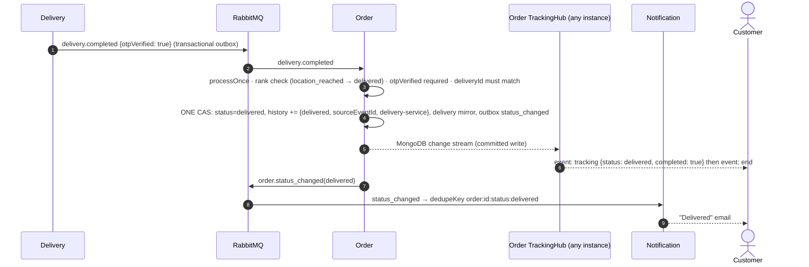

### 18.7 Cancellation policy

| Order state when cancelled | Who may cancel (Order Service `CANCELLABLE_BY`) | Delivery effect | Money |
|---|---|---|---|
| `confirmed` (preparing) | customer, restaurant, platform | delivery → cancelled, no ready event ever | refund via the existing `order.cancelled` → Payment/Billing flow |
| `assigning_delivery_partner` | restaurant, platform | delivery → cancelled (also from `assignment_failed`) | refund |
| `partner_assigned` (before pickup) | platform | delivery → cancelled, **partner released**, pickup now 409 `DELIVERY_CANCELLED` | refund |
| `out_for_delivery`, `location_reached` | **nobody** (409 `ORDER_NOT_CANCELLABLE`) — the food is with the partner | — | — (support process, not automated) |
| `delivered`, `cancelled`, `expired` | nobody | — | — |

- A cancellation that reaches Delivery *before* the confirmation leaves a **tombstone** (status cancelled, `orderId` taken),
  so a delayed `order.confirmed` never starts a delivery. `order.expired` does the same.
- If a cancellation races a pickup (platform cancels while the partner taps "picked up"), the Order Service ignores the
  late `delivery.picked_up` (order closed), Delivery cancels its record, releases the partner and invalidates any OTP — the order
  can never become delivered.
- Duplicate cancellation events are absorbed (`processOnce` + "already cancelled → ignored"); `delivery.cancelled` is published once.
- **No automatic refund for delivery problems.** A delivery that cannot find a partner ends in `assignment_failed`
  (order stays `assigning_delivery_partner`, payment stays `paid`, tracking shows `deliveryIssue`). An operator either re-queues the
  assignment or cancels the order, which triggers the normal refund.

### 18.8 Failure handling

| Failure | Behaviour |
|---|---|
| RabbitMQ down | partner actions still commit (events wait in the Delivery outbox); the Order Service catches up after recovery. *Verified live (R1).* |
| Notification Service down | OTP command waits in its durable restricted queue; the email is sent after restart (OTP verification is possible as soon as the email arrives). *Verified (R2).* |
| SMTP down | OTP email retried every ≤ 15 s until the code expires; never sent after expiry; a reissued code supersedes an unsent older one |
| Delivery Service restart | preparation/assignment deadlines are in MongoDB; the next scheduler tick resumes. *Verified (R3).* |
| MongoDB down | `/health` → 503 (critical dependency); requests fail fast; the driver reconnects; nothing is lost. *Verified (R4).* |
| No partner available | bounded retries (`ASSIGNMENT_MAX_ATTEMPTS`, `ASSIGNMENT_TIMEOUT_MS`), then `assignment_failed` + event; operator retry |
| Two scheduler instances | every step is a compare-and-set inside a transaction; the unique `activeDeliveryId` index is the last line of defence (a lost race rolls back) |
| OTP email lost / expired / too many wrong codes | partner requests a reissue: cooldown 30 s, at most 3 codes per delivery; after that, support |

### 18.9 Live tracking (SSE)

`GET /orders/:id/tracking/stream` (JWT in the `Authorization` header; same access rules as `GET /orders/:id/tracking`: owner,
platform admin, assigned partner). The response is `text/event-stream`: a snapshot on connect, then one `event: tracking` per committed
change (`id:` = history length), heartbeats every 15 s, and `event: end` once the order is **settled** (delivered, or
cancelled/expired with a final payment outcome — a cancelled paid order keeps streaming until its refund lands; fixed in Stage 8).

- **Source:** each Order Service instance opens **one MongoDB change stream** on `orders` (committed writes only) and fans out to its
  own subscribers. Any instance sees every change, whichever instance or consumer made it, so horizontal scaling needs no sticky
  sessions or shared in-process emitter. If the change stream fails, it restarts and every subscriber gets a fresh snapshot.
- **Reconnection:** clients reconnect (SSE `retry: 3000`); every connection starts with the current snapshot, so nothing committed
  in between is missed.
- **Gateway:** a dedicated nginx location turns off buffering and allows 1 h reads.
- **Payload:** the tracking view — status, delivery status, partner name + masked phone, code *expiry* (never the code), timestamps,
  full history. No customer contact data, verifiers or broker details.
- Trade-off: browsers' `EventSource` cannot set headers; a frontend uses `fetch()` streaming (or an EventSource polyfill with headers).
  Tokens are deliberately not accepted in the query string (they would land in access logs). Polling `GET /orders/:id/tracking` remains available.

### 18.10 Security summary

- Partner identity comes **only from the verified JWT** (`sub`, role `delivery_agent`); request bodies are strict and never name an agent.
  Non-assigned partners get 404 (delivery ids are not probeable); other roles get 403.
- Partners are seeded through the Auth Service (`POST /auth/users` by a platform admin) and register their profile with their own token
  (`PUT /deliveries/agents/me`). The shared demo password comes from `.env` (`DELIVERY_AGENT_PASSWORD`, generated); the seed refuses `NODE_ENV=production`.
- OTP: CSPRNG, 6 digits, 5-minute TTL, 5 attempts (counted atomically before comparing), keyed HMAC verifier bound to delivery + sequence,
  constant-time comparison, consumed exactly once, at most 3 issues with a cooldown. The plaintext exists only in memory in the arrival
  transaction and, sealed, in the restricted command; it is never in `delivery.*`/`order.*` events, order history, tracking, API responses or logs.
- The Notification Service has no gateway route; neither do RabbitMQ queues or the OTP command.
- Secrets (`OTP_HMAC_KEY`, X25519 key pair, broker passwords, partner password) live only in the git-ignored `.env`.

### 18.11 Limitations

- A reserved partner stays reserved until pickup or cancellation (no pickup timeout or reassignment). Test suites cancel or complete
  what they leave open.
- Assignment is random among available partners (no distance/route optimisation, by design).
- Preparation is simulated by a delay; restaurants have no "ready" button yet.
- After pickup, cancellation is not possible through the API; returns/refunds after pickup are a support process.
- SSE requires header-capable clients (see 18.9); there is no WebSocket channel.

---

## 19. Developer tooling and observability (Stage 8)

Development-only additions that make the system explorable without touching the business architecture. Nothing here is part of a
production deployment, and none of it bypasses authentication, state machines, OTP verification or service boundaries.

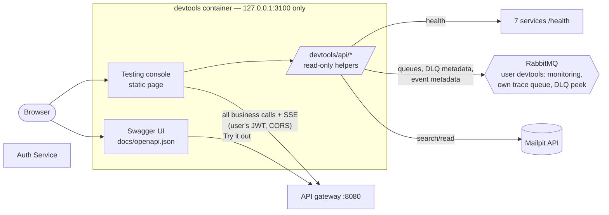

| Piece | What it does | Boundaries |
|---|---|---|
| **OpenAPI 3.1** (`docs/openapi.mjs` → `docs/openapi.json`) | every client-facing endpoint: schemas, JWT, roles (`x-roles`), errors, examples | `scripts/openapi.mjs check` fails if spec, Express routes (parsed from source) and gateway routes disagree; internal surfaces are excluded |
| **Swagger UI** (`/docs`) | browse and "Try it out" against the gateway | served by devtools, pinned `swagger-ui-dist` 5.17.14 |
| **Testing console** (`/`) | role-aware: registration/login forms; platform admin (create accounts — a new restaurant admin must be assigned to ≥1 restaurant, with a safe retry of failed assignments —, users, create restaurants, add/remove restaurant administrators), restaurant admin (assigned restaurants via `/restaurants/mine`, details, menu, prices, availability, open/close, orders), delivery agent (availability, pickup, arrival, code), customer (order → pay → track → cancel); plus health, queues, request log | every business action goes to the gateway with the signed-in user's JWT; backend RBAC and assignment checks apply unchanged; tokens only in memory |
| **Observability helpers** (`/devtools/api/*`) | aggregated health of gateway + 7 services (each reports MongoDB/RabbitMQ), RabbitMQ overview and queue depths, dead-letter metadata, recent event metadata per order, Mailpit search | broker user `devtools`: `monitoring` tag, topic write `^$` (cannot publish), configure/write only its own `devtools.*` queue, read on `food.events` (to bind) and on DLQs **except the OTP DLQ**; event and DLQ views show ids, types, correlation ids and last errors — never payloads; no database access |
| **Scenario runner** (`scripts/scenarios.mjs`) | 8 scripted stories with Markdown/JSON reports (steps, checks, order, final state, events, errors) | uses only the gateway, Mailpit and the RabbitMQ management API; outages via `docker compose stop/start` |

Gateway change: `Access-Control-Expose-Headers: x-request-id, retry-after, idempotent-replayed`, so browser clients can read tracing and
retry headers. Defect fixed while building the console: the SSE stream used to end when an order became *terminal*, so a cancelled
paid order never streamed its refund; it now ends when the order is *settled* (new `settled` field in the tracking view).

---

## 20. Restaurant administration: many-to-many assignments (Stage 8.2)

### 20.1 Model and permissions

The Catalog Service's `restaurants` document replaced the single `ownerId` with **`adminIds: string[]`** (Auth user ids, indexed) and
`adminAssignedAt: { <userId>: Date }` (when each administrator was assigned; used for ordering, §20.3). A restaurant may have any number
of administrators, an administrator any number of restaurants, and all administrators of a restaurant have **identical** permissions —
there is no owner, manager or staff hierarchy.

| Action | platform_admin | restaurant_admin (assigned) | restaurant_admin (not assigned) | customer / anonymous |
|---|---|---|---|---|
| Create restaurant (`POST /restaurants`, optional initial `adminIds`) | ✅ | ❌ | ❌ | ❌ |
| Assign / remove administrators (`POST /restaurants/:id/admins`, `DELETE …/admins/:userId`) | ✅ | ❌ | ❌ | ❌ |
| `GET /restaurants/mine` | — | ✅ | ✅ (empty) | ❌ |
| Update details, open/close, menu, prices, availability | ✅ | ✅ | ❌ 403 | ❌ |
| Change `status` (active/inactive), soft delete | ✅ | ❌ | ❌ | ❌ |
| View and cancel the restaurant's orders (Order Service, via its projection) | ✅ | ✅ | ❌ 403 | ❌ |
| See `adminIds` in responses | ✅ (all) | ✅ (own restaurants) | ❌ | ❌ |

Enforcement is local: the Catalog Service checks the JWT role and membership in `adminIds`; the Order Service checks the same
membership in its catalog projection. **No Auth user projection and no synchronous call to the Auth Service** exist; the Catalog
therefore cannot verify that an assigned id belongs to a `restaurant_admin` (only the role in the caller's own JWT is trusted). The
console only offers `restaurant_admin` accounts, and an id of another role grants nothing because every check also requires the
`restaurant_admin` role.

Assignment writes are atomic single-document updates: `$addToSet` + `$set adminAssignedAt.<id>` (only when not already assigned, so
re-assigning is a no-op that keeps the original timestamp) and `$pull` + `$unset`. Each effective change bumps `catalogVersion` and writes a
`catalog.restaurant.updated.v2` snapshot to the outbox in the same transaction.

### 20.2 Deactivation flow

```mermaid
sequenceDiagram
    participant PA as Platform admin
    participant A as Auth Service
    participant MQ as RabbitMQ
    participant C as Catalog Service
    participant O as Order Service
    PA->>A: PATCH /auth/users/:id/status {isActive:false}
    A->>A: txn: isActive true→false + outbox auth.user.deactivated.v1
    A-->>PA: 200 (user inactive; login refused)
    A--)MQ: relay publishes auth.user.deactivated.v1
    MQ--)C: catalog-service.auth-events
    C->>C: per restaurant: $pull userId (assigned before deactivatedAt) + outbox v2 snapshot
    C--)MQ: catalog.restaurant.updated.v2 (new catalogVersion)
    MQ--)O: order-service.catalog-events → projection adminIds updated (version CAS)
```

- **Auth** received RabbitMQ connectivity for this: its own broker user `auth-service` (topic write `^auth\.` only), an `outbox_events`
  collection and an `OutboxRelay`. The status change and the outbox write are one MongoDB transaction; the update is conditional on
  `isActive: true`, so deactivating an inactive account changes nothing and publishes nothing. Self-deactivation stays forbidden.
- **Permanent deletion** (Stage 9, §23) is possible only after deactivation and removes any remaining assignments of the id.
- **Reactivation** (`isActive: true`) is a plain update and publishes no event. It **restores no assignments** and no backup of the
  former assignments is kept; a platform admin re-assigns explicitly.

### 20.3 Ordering, duplicates and delayed events

The Catalog consumer is idempotent **by state**, without `processOnce`: a repeated event finds nothing left to remove. It is also **order-safe**: it removes the user only from
restaurants where `adminAssignedAt[userId]` is missing (pre-Stage-8.2 data) or **earlier than the event's `deactivatedAt`**. Hence:

- a duplicate or redelivered event finds nothing left to remove (no snapshot is published);
- deactivate → reactivate → re-assign → *late* deactivation event: the new assignment is newer than `deactivatedAt` and survives;
- in the Order Service, every removal is a newer `catalogVersion`, so an older snapshot (periodic broadcast, redelivery) can never restore
  a removed administrator.

Caveat: the comparison uses the Auth clock (`deactivatedAt`) against the Catalog clock (`adminAssignedAt`). An assignment made within the
clock skew between the two containers (milliseconds locally, same host) of the deactivation could be misclassified.

### 20.4 Eventual consistency and the JWT revocation window

- Deactivation blocks **new logins immediately**, but an already-issued access token stays valid until it expires (`JWT_EXPIRES_IN`,
  ≤ 1 h by default) because services verify JWTs locally. Catalog management access ends when the deactivation event has been processed
  (normally milliseconds; longer if the broker or the Catalog is down — the outbox and durable queue deliver it after recovery);
  Order Service access ends when the resulting v2 snapshot reaches its projection. Immediate token revocation (deny-list or
  short-lived tokens + refresh) is a separate, future enhancement.
- Assignment changes take effect in the Catalog immediately and in the Order Service after the snapshot is consumed.

### 20.5 Event versioning and migration

- `catalog.restaurant.updated.v2` replaces v1 (`ownerId` → `adminIds`, a breaking change). Producer and the single consumer were upgraded
  together, so v1 is retired: the Catalog publishes only v2 (per-event versions via `EVENT_VERSIONS`), and the Order Service unbinds the v1
  routing key from its queue at startup and rejects any v1 message as permanent (dead-lettered, visible in the DLQ).
- **Catalog migration** (on every startup, idempotent): each restaurant still having an `ownerId` field gets `adminIds = [ownerId]`
  (merged with any existing ids; `null` → `[]`), `adminAssignedAt[ownerId]` = migration time, the `ownerId` field removed, its
  `catalogVersion` bumped and a v2 snapshot published; restaurants lacking `adminIds` get `[]`. Nothing else is changed or deleted.
- **Order projection migration** (on startup, idempotent) converts stored `ownerId` to `adminIds` the same way; the Catalog's version-bumped
  snapshots then overwrite it with authoritative data.
- Seed data starts every restaurant with `adminIds: []`.

---

## 21. Service reference

One card per microservice, checked against the code: `server.ts`, `config.ts`, `consumers/` and `models/`. The endpoint lists name the gateway paths; request and
response details are in [API.md](API.md) and Swagger UI. Environment variables listed here are the service-specific ones. Every service except
Notification also needs the common `MONGO_URI`, `JWT_SECRET`/`JWT_ISSUER`/`JWT_AUDIENCE`, `RABBITMQ_URL`, `EVENT_EXCHANGE`,
`OUTBOX_POLL_INTERVAL_MS`, `CORS_ORIGINS`, `PORT`, `LOG_LEVEL` and `NODE_ENV` (full table: [DEPLOYMENT_GUIDE §7](DEPLOYMENT_GUIDE.md#7-environment-variables)).
Every service's `/health` treats MongoDB as critical (503 when down). RabbitMQ is optional (200 `degraded`), because writes still commit and events wait in the outbox.

### 21.1 Auth Service

| | |
|---|---|
| Purpose | identities, credentials and roles; issues JWTs; account moderation |
| Source / Dockerfile / port | `services/auth/` · `services/auth/Dockerfile` · 4001 |
| Endpoints | `POST /auth/register` (public, always `customer`), `POST /auth/login`, `GET /auth/verify`, `GET/PATCH /auth/me`, `POST /auth/me/password`; platform admin: `GET /auth/users`, `POST /auth/users`, `PATCH /auth/users/:id/status`, `DELETE /auth/users/:id` |
| Publishes | `auth.user.deactivated.v1` (outbox, same transaction as the status change; never for an already-inactive account); `auth.user.deleted.v1` (outbox, same transaction as the delete) |
| Consumes | `auth-service.delivery-events` ← `delivery.partner_assigned/completed/cancelled.v1` (agent-delivery projection, §23) |
| Database | `auth_db`: `users` (unique email, bcrypt hash, role, `isActive`, saved addresses), `agent_deliveries` (projection), `locks` (admin-deactivation lock), `outbox_events` |
| Infrastructure | MongoDB (critical), RabbitMQ user `auth-service` (publish `^auth\.` only; reads its own `auth-service.*` queues) |
| Background work | outbox relay; bootstrap admin creation at startup |
| Health | `GET /health`: mongo critical, rabbitmq optional |
| Key env | `JWT_EXPIRES_IN` (1h), `BCRYPT_ROUNDS`, `ADMIN_EMAIL`, `ADMIN_PASSWORD`, `ADMIN_NAME` |

### 21.2 Catalog Service

| | |
|---|---|
| Purpose | restaurants and menus (authority), restaurant administrator assignments, browsing/search |
| Source / Dockerfile / port | `services/catalog/` · `services/catalog/Dockerfile` · 4002 |
| Endpoints | public: `GET /restaurants`, `/restaurants/cuisines`, `/restaurants/:id`, `/restaurants/:id/menu`, `/restaurants/:id/menu/:itemId`; restaurant admin: `GET /restaurants/mine`; assigned admin or platform admin: `PATCH /restaurants/:id`, `PATCH /restaurants/:id/open`, `POST/PATCH/DELETE /restaurants/:id/menu[/:itemId]`, `PATCH …/availability`; platform admin: `POST /restaurants`, `DELETE /restaurants/:id`, `POST /restaurants/:id/admins`, `DELETE /restaurants/:id/admins/:userId` |
| Publishes | `catalog.restaurant.updated.v2`: on every change (outbox), at startup, every `CATALOG_SNAPSHOT_INTERVAL_MS` and on request |
| Consumes | `catalog-service.sync-requests` ← `catalog.sync_requested.v1`; `catalog-service.auth-events` ← `auth.user.deactivated.v1`, `auth.user.deleted.v1` |
| Database | `catalog_db`: `restaurants` (`adminIds`, `adminAssignedAt`, `catalogVersion`), `menuitems`, `deleted_users` (tombstones), `outbox_events` |
| Infrastructure | MongoDB, RabbitMQ user `catalog-service` (publish `^catalog\.restaurant\.`) |
| Background work | outbox relay; periodic snapshot broadcast; optional seeding; `ownerId → adminIds` migration at startup |
| Health | mongo critical, rabbitmq optional |
| Key env | `SEED_ON_START`, `CATALOG_SNAPSHOT_INTERVAL_MS` (300000) |
| Seeding | full demo catalog `src/seed/data.ts` (on start when `SEED_ON_START=true`, or `npm run seed`); sample `src/seed/sample-data.ts` (`run.js --sample`); both insert-only and idempotent |

### 21.3 Order Service

| | |
|---|---|
| Purpose | order placement and pricing, cancellation, **sole authority over order status**, expiry of unpaid orders, tracking |
| Source / Dockerfile / port | `services/order/` · `services/order/Dockerfile` · 4003 |
| Endpoints | `POST /orders` (customer; `Idempotency-Key`), `GET /orders`, `GET /orders/:id`, `GET /orders/:id/tracking`, `GET /orders/:id/tracking/stream` (SSE), `POST /orders/:id/cancel` |
| Publishes | `order.created.v1`, `order.confirmed.v1`, `order.cancelled.v1`, `order.expired.v1`, `order.status_changed.v1`, `catalog.sync_requested.v1` |
| Consumes | `order-service.catalog-events` ← `catalog.restaurant.updated.v2`; `order-service.billing-events` ← `billing.finalized.v1` (+ legacy `billing.invoice_generated.v1`); `order-service.payment-events` ← `payment.succeeded/failed/cancelled.v1`, `payment.refund.completed/failed.v1`; `order-service.delivery-events` ← `delivery.ready_for_pickup/partner_assigned/picked_up/location_reached/completed/cancelled/assignment_failed.v1` |
| Database | `order_db`: `orders` (items snapshot, `statusHistory`, mirrored `paymentStatus` and delivery), `catalog_restaurants` (projection), `outbox_events`, `processed_events` |
| Infrastructure | MongoDB (replica set: transactions + change stream), RabbitMQ user `order-service` (publish `^(order\|catalog\.sync_requested)\.`) |
| Background work | outbox relay; **expiration worker** (`EXPIRY_SWEEP_INTERVAL_MS`); tracking change stream; startup sync request when the projection is empty |
| Health | mongo critical, rabbitmq optional. Order placement returns 503 `CATALOG_SYNC_PENDING`/`CATALOG_SYNC_UNAVAILABLE` while the projection may be stale |
| Key env | `ORDER_PAYMENT_DEADLINE_SECONDS` (900), `EXPIRY_SWEEP_INTERVAL_MS`, `EXPIRY_BATCH_SIZE`, `DELIVERY_FEE`, `FREE_DELIVERY_THRESHOLD` |

### 21.4 Payment Service

| | |
|---|---|
| Purpose | one payment per order for exactly Billing's `finalAmount`; provider integration (mock or Stripe test mode); refunds |
| Source / Dockerfile / port | `services/payment/` · `services/payment/Dockerfile` · 4004 |
| Endpoints | `POST /payments/initiate` (customer), `GET /payments`, `GET /payments/order/:orderId`, `GET /payments/:id`, `POST /payments/:id/refund` (platform admin), `POST /payments/webhook` (provider-signed), `POST /payments/:id/simulate` (only with `ENABLE_TEST_ENDPOINTS=true`) |
| Publishes | `payment.succeeded.v1`, `payment.failed.v1`, `payment.cancelled.v1`, `payment.refund.completed.v1`, `payment.refund.failed.v1` |
| Consumes | `payment-service.order-events` ← `order.created/cancelled/expired.v1`; `payment-service.billing-events` ← `billing.finalized.v1` (+ legacy) |
| Database | `payment_db`: `payments`, `refunds`, `mock_provider_objects` (mock only), `outbox_events`, `processed_events` |
| Infrastructure | MongoDB, RabbitMQ user `payment-service` (publish `^payment\.`); Stripe API only with `PAYMENT_PROVIDER=stripe` |
| Background work | outbox relay; **reconciler** (`RECONCILE_INTERVAL_MS`): drives provider calls outside transactions, polls stuck intents/refunds |
| Health | mongo critical, rabbitmq optional |
| Key env | `PAYMENT_PROVIDER`, `STRIPE_SECRET_KEY`, `STRIPE_WEBHOOK_SECRET`, `MOCK_WEBHOOK_SECRET`, `MOCK_WEBHOOK_URL`, `ENABLE_TEST_ENDPOINTS`, `RECONCILE_INTERVAL_MS`, `PROVIDER_POLL_AFTER_MS` |

### 21.5 Billing Service

| | |
|---|---|
| Purpose | immutable itemised invoices, discount codes, the final payable amount, ledger adjustments for payments/refunds/voids |
| Source / Dockerfile / port | `services/billing/` · `services/billing/Dockerfile` · 4005 |
| Endpoints | `GET /invoices`, `GET /invoices/order/:orderId`, `GET /invoices/:id` (owner or platform admin); `GET /discounts` (public); `POST /discounts`, `PATCH /discounts/:code` (platform admin) |
| Publishes | `billing.finalized.v1` |
| Consumes | `billing-service.events` ← `order.created/cancelled/expired.v1`, `payment.succeeded.v1`, `payment.refund.completed/failed.v1` |
| Database | `billing_db`: `invoices` (immutable), `billing_entries` (immutable ledger), `discounts`, `outbox_events`, `processed_events` |
| Infrastructure | MongoDB, RabbitMQ user `billing-service` (publish `^billing\.`) |
| Background work | outbox relay; discount seeding at startup |
| Health | mongo critical, rabbitmq optional |
| Key env | `MIN_PAYABLE_AMOUNT` (100), `SEED_DISCOUNTS` |

### 21.6 Delivery Service

| | |
|---|---|
| Purpose | a delivery per confirmed order: simulated preparation, random atomic partner assignment, partner actions, OTP handover |
| Source / Dockerfile / port | `services/delivery/` · `services/delivery/Dockerfile` · 4007 |
| Endpoints | delivery agent: `GET/PUT /deliveries/agents/me`, `GET /deliveries`, `GET /deliveries/:id`, `POST /deliveries/:id/pickup`, `/arrived`, `/verify-otp`, `/resend-otp` (assigned agent only); platform admin: `GET /deliveries/agents`, `GET /deliveries`, `GET /deliveries/order/:orderId`, `GET /deliveries/:id`, `POST /deliveries/:id/retry-assignment` |
| Publishes | `delivery.ready_for_pickup/partner_assigned/picked_up/location_reached/completed/cancelled/assignment_failed.v1` on `food.events`; `notification.delivery_otp.v1` on **`food.restricted`** |
| Consumes | `delivery-service.order-events` ← `order.confirmed/cancelled/expired.v1`; `delivery-service.auth-events` ← `auth.user.deactivated.v1`, `auth.user.deleted.v1` |
| Database | `delivery_db`: `deliveries`, `delivery_agents`, `delivery_otps` (HMAC verifiers only), `account_blocks`, `outbox_events`, `processed_events` |
| Infrastructure | MongoDB, RabbitMQ user `delivery-service` (publish `^delivery\.`, write-only on `food.restricted`) |
| Background work | outbox relay; **scheduler** (`WORKER_INTERVAL_MS`): preparation deadlines, assignment attempts and retries |
| Health | mongo critical, rabbitmq optional |
| Key env | `OTP_HMAC_KEY`, `NOTIFICATION_OTP_PUBLIC_KEY`, `PREPARATION_DELAY_MS`, `ASSIGNMENT_*`, `OTP_TTL_MS`, `OTP_MAX_ATTEMPTS`, `OTP_MAX_ISSUES`, `OTP_RESEND_COOLDOWN_MS` |

### 21.7 Notification Service

| | |
|---|---|
| Purpose | customer emails for order status changes and delivery codes (HTML + text), with durable retries |
| Source / Dockerfile / port | `services/notification/` · `services/notification/Dockerfile` · 4006 (internal; not published, no gateway route) |
| Endpoints | none except `GET /health` |
| Publishes | nothing (broker topic write `^$`) |
| Consumes | `notification-service.order-events` ← `order.#` (emails only for `order.status_changed.v1`); `notification-service.delivery-otp` ← `notification.delivery_otp.v1` on `food.restricted` (the only reader) |
| Database | `notification_db`: `notifications` (unique `dedupeKey`, attempts, status; the sealed OTP is kept only until sent or abandoned) |
| Infrastructure | MongoDB, RabbitMQ user `notification-service`, SMTP server (Mailpit) |
| Background work | **sender** (`SENDER_INTERVAL_MS`, leases `SEND_LEASE_MS`, ≤ `NOTIFY_MAX_ATTEMPTS`); SMTP probe every 15 s |
| Health | mongo critical; rabbitmq, smtp, otpKey optional |
| Key env | `SMTP_HOST`, `SMTP_PORT`, `SMTP_SECURE`, `SMTP_USER`, `SMTP_PASSWORD`, `MAIL_FROM`, `APP_NAME`, `NOTIFY_MAX_ATTEMPTS`, `NOTIFICATION_OTP_PRIVATE_KEY` (no JWT variables) |

### 21.8 Supporting components

| Component | Notes |
|---|---|
| API gateway (`infra/nginx`) | nginx on :80 (host 8080). Routes by path prefix, has no business logic, rate-limits `/auth/*`, passes SSE through, forwards webhook bodies unchanged, serves `/health` and `/health/<svc>`. Uses Docker DNS (`resolver 127.0.0.11`); see DEPLOYMENT_GUIDE §4 |
| RabbitMQ | `rabbitmq:4.1-management-alpine`, volume `rabbitmq-data`, stable hostname `rabbitmq`; management UI on :15672 |
| `rabbitmq-setup` | one-shot job (`infra/rabbitmq-setup/setup.mjs`): declares `food.events` and `food.restricted`, creates per-service users, permissions and topic permissions plus the read-only `devtools` user, and migrates legacy queues only if they are empty |
| MongoDB | `mongo:8.0`, single-node replica set `rs0`, volume `mongo-data` |
| Mailpit | `axllent/mailpit:v1.31.6`, SMTP :1025, UI/API :8025, no volume, retained for the final demo |
| devtools | testing console, Swagger UI and read-only helpers on 127.0.0.1:3100 (§19); development only |
| frontend | React web app for all four roles (§22), nginx static image on :3000; calls only the gateway |

---

## 22. Web frontend

`frontend/` is a React 19 + TypeScript + Vite single-page app. It is the user-facing client for all four roles; the testing console (§19)
remains the developer tool. It adds **no business logic and no backend endpoints**: every action is one of the documented gateway calls, made with the
signed-in user's JWT, and the services enforce roles, assignments and state machines exactly as for any other client.

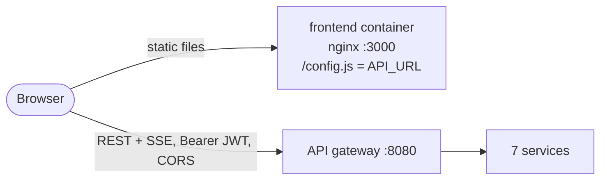

| Concern | Choice |
|---|---|
| Gateway access | direct cross-origin calls to the gateway URL from runtime config (`/config.js`, written from `API_URL` at container start); no proxy in the frontend container |
| Session | JWT + user in `sessionStorage` (per tab, survives reloads); logout on expiry or `TOKEN_EXPIRED`/`INVALID_TOKEN`; a deactivated account (404 on `/auth/me`) is logged out |
| Authorization | `ProtectedRoute` per role area; the UI hides actions a role cannot perform, while the backend remains the security boundary |
| Pricing | the cart shows an estimate only; the order total comes from the Order Service, the payable amount from the Billing invoice; prices are never sent |
| Order placement | `Idempotency-Key` per checkout, so retries never duplicate an order; `CATALOG_SYNC_PENDING` is retried with the same key |
| Payment | mock provider only (`POST /payments/:id/simulate`), labelled as simulated; `BILLING_PENDING` is retried using `Retry-After` |
| Tracking | SSE stream read with `fetch` (the JWT travels in the `Authorization` header), with polling fallback; renders server snapshots only |
| Delivery code | entered by the agent, verified by the Delivery Service; never generated, stored or shown by the app; Mailpit is not linked |
| Restaurant admin creation | account first, then each assignment; failed assignments are retried alone, and the account is never created twice |
| Account search and deletion | all pages of the selected role are loaded, then filtered client-side by name, email or id (no search API); Delete only for inactive accounts other than your own, behind a dialog with name, email, role and an explicit acknowledgement (§23) |

Details, routes and verification status: [frontend/README.md](frontend/README.md).

## 23. Permanent account deletion (Stage 9)

`DELETE /auth/users/:id` lets a platform administrator permanently delete an **inactive** account. Downstream services clean up their
references through `auth.user.deleted.v1`; business records are **never** deleted.

### 23.1 Flow

```mermaid
sequenceDiagram
    participant PA as Platform admin
    participant A as Auth Service
    participant MQ as RabbitMQ
    participant C as Catalog
    participant D as Delivery
    participant O as Order
    PA->>A: PATCH /auth/users/:id/status {isActive:false}
    A--)MQ: auth.user.deactivated.v1
    PA->>A: DELETE /auth/users/:id
    A->>A: txn: checks + deleteOne({_id, isActive:false}) + outbox auth.user.deleted.v1
    A-->>PA: 200 {id, role, deletedAt}
    A--)MQ: relay publishes auth.user.deleted.v1
    MQ--)C: tombstone id; $pull from every adminIds + v2 snapshot
    C--)MQ: catalog.restaurant.updated.v2
    MQ--)O: projection adminIds updated
    MQ--)D: account block (deleted): no new assignments, cannot go available
```

### 23.2 Rules enforced by Auth (one transaction)

| Check | Result |
|---|---|
| Caller is the target | 403 `CANNOT_DELETE_SELF` |
| Caller is no longer an active platform admin in `auth_db` (JWT still valid) | 403 `ACTOR_NOT_ACTIVE` |
| Target missing (incl. a repeated request) | 404, no event |
| Target active | 409 `USER_ACTIVE`: deactivate first |
| Target is a delivery agent with an active delivery | 409 `AGENT_HAS_ACTIVE_DELIVERY` |

The delete is a compare-and-delete on `isActive: false`. A concurrent reactivation or a second delete conflicts inside the transaction; after the
retry the request returns 409 or 404, and in neither case is an event written. The event is written only when the document was removed.

**Platform administrators.** Deleting an *inactive* admin cannot reduce the number of active admins, and the caller is one. The real risk is
deactivation. Since Stage 9, deactivating a platform admin requires another active admin (409 `LAST_ACTIVE_ADMIN`). Every admin deactivation
increments a shared document (`auth_db.locks`, `_id: platform-admins`) in its transaction. Two concurrent deactivations therefore hit a write
conflict, and the retried one recounts. Two admins deactivating each other at the same moment leave one active admin.

### 23.3 Delivery agents

Auth cannot query Delivery synchronously, so it keeps a small projection (`auth_db.agent_deliveries`) from `delivery.partner_assigned.v1`
(active) and `delivery.completed.v1` / `delivery.cancelled.v1` (closed, terminal). It refuses deletion while the agent holds an active delivery.

The Delivery Service consumes `auth.user.deactivated.v1` and `auth.user.deleted.v1` into `account_blocks`:

- A blocked agent is skipped by assignment. They are taken offline at once, or, if they hold a delivery, when it is released.
- A blocked agent cannot register or go available (403 `ACCOUNT_DISABLED` / `ACCOUNT_DELETED`).
- A delivery the agent already holds **stays theirs**, so it is not orphaned. Their still-valid token can finish it, or the order can be cancelled.
- A *deactivation* block lifts when the agent presents a JWT **issued after** it. Only a reactivated account can obtain such a token.
  `reenabledAt` stops a delayed deactivation event from re-blocking them.
- A *deletion* block is permanent. Delivery history and `delivery_agents` records are kept, so historical deliveries still name the agent.

Residual window: an assignment committed just before Delivery processed the deactivation, whose `partner_assigned` event has not yet reached
Auth, is not seen by the check. Deletion then succeeds, the delivery stays with the deleted agent, and Delivery logs a warning. There is no
automatic reassignment workflow. The projection only contains assignments made after Stage 9 was deployed. At deployment the local stack had no
in-flight deliveries, so no backfill was needed.

### 23.4 Restaurant administrators and other roles

- **Catalog** tombstones the id (`deleted_users`) and removes it from **every** restaurant's `adminIds`, without the deactivation timestamp
  cut-off. Ids are MongoDB ObjectIds and are never reused, so no assignment of that id can belong to a newer identity. Each change bumps
  `catalogVersion` and publishes a v2 snapshot, so the Order Service projection follows. Restaurants and menus are untouched.
  Tombstoned ids are refused by `POST /restaurants` and `POST /restaurants/:id/admins` (409 `USER_DELETED`).
- **Customers.** Nothing is cascaded. Orders, payments and refunds, invoices and ledger entries, delivery records and notification logs keep the `customerId`
  and the name, email and address snapshots captured at the time. No service reads live Auth records to serve history or process events,
  because they rely on the JWT and their own snapshots. Deletion is therefore **not** complete personal-data erasure.
- **Order, Payment, Billing, Notification** need no consumer.

### 23.5 JWT revocation limitation

Services verify JWTs locally, so a deleted or deactivated user's token stays cryptographically valid until it expires (`JWT_EXPIRES_IN`,
≤ 1 h):

- a deleted **customer** can still read their orders and place or pay for orders during that window;
- a deleted **restaurant admin** loses management access once Catalog and the Order projection have processed the event;
- a deleted **agent** cannot go available or receive new work, but could act on a delivery they still hold;
- a deleted **platform admin** is refused by the Auth admin endpoints that re-check the caller (`DELETE /auth/users/:id`), but other services' admin endpoints accept the token until it expires.

The smallest future improvement is a **revocation list fed by these events**: each service already consumes or could consume
`auth.user.deactivated/deleted`, could store `{userId, at}`, and could reject tokens with `iat` older than `at` in the shared `authenticate()`
middleware. `AuthUser.issuedAt` was added for this; Delivery already uses it. The alternative is shorter access tokens with refresh tokens.

