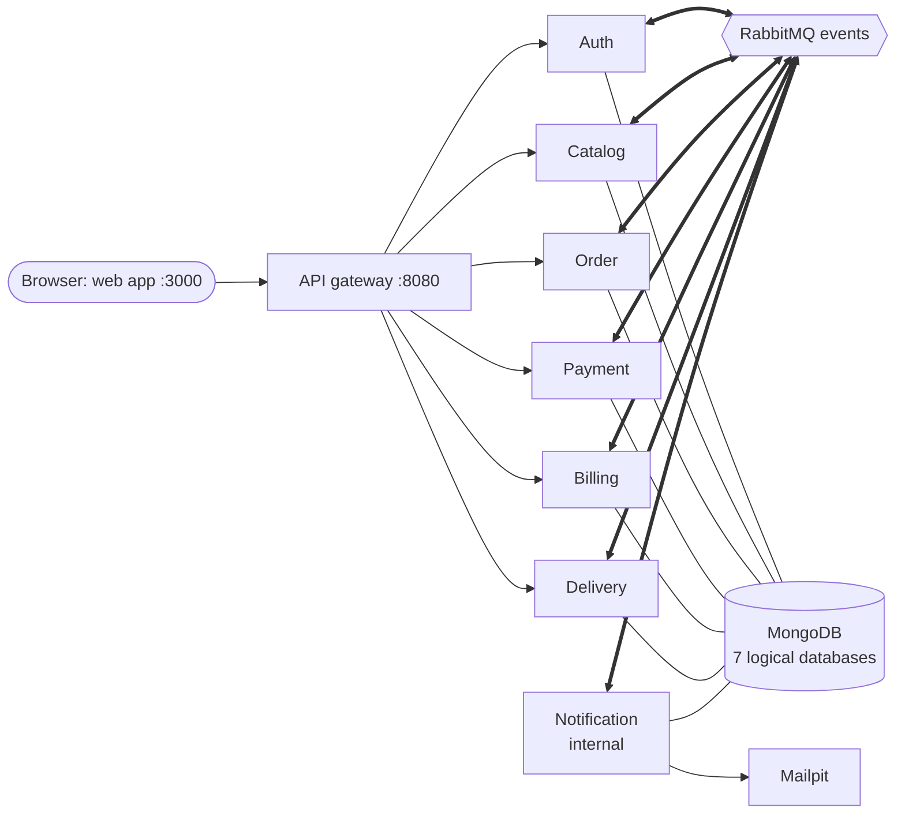

# Food Ordering Platform

A cloud-native, **event-driven microservices** food ordering backend in the style of Swiggy or Zomato, at university scale. It was built for a cloud computing course.
Customers browse restaurants, order, pay with a mock card provider and track the delivery live. Delivery partners confirm the handover with a
one-time code that the customer receives by email. The system runs **locally with Docker Compose**; nothing has been deployed to a cloud yet.

> **New to the project? Read [TEAM_HANDOVER.md](TEAM_HANDOVER.md) first.** It explains the architecture, the order lifecycle, events,
> databases, roles, local setup, testing and cloud prerequisites, and gives a reading order for the other documents.

## Technology stack

Node.js 24 · TypeScript 7 · Express 5 · MongoDB 8 (replica set) · RabbitMQ 4.1 · nginx gateway · Docker Compose · Vitest ·
JWT (HS256) · zod · pino. **Web frontend:** React 19 + TypeScript + Vite in [`frontend/`](frontend/README.md). Payments use a mock provider by default (Stripe test mode supported, unverified). Emails are captured by **Mailpit**.

## Architecture at a glance



- **A React web app** (`frontend/`, its own container) for customers, restaurant administrators, delivery agents and platform administrators. It calls only the gateway.
- **Seven microservices.** Each owns its own logical database: Auth, Catalog, Order, Payment, Billing, Delivery and Notification.
- **Clients use REST** through the gateway only.
- **Services talk only through RabbitMQ events**, using a transactional outbox, idempotent consumers, retries, dead-letter queues and per-service broker users.
- **The Order Service** is the single authority over order status. It prices orders from a local, event-fed copy of the catalog.
- **Restaurant administration** is many-to-many (`adminIds`). Only platform admins create restaurants and assign administrators.
- **Account lifecycle.** Platform admins deactivate accounts, and can then permanently delete inactive ones. Downstream services clean up
  their references through RabbitMQ events (ARCHITECTURE §23).

Details: [ARCHITECTURE.md](ARCHITECTURE.md), especially §21 (one card per service) and §16 (events).

## Quick start

Prerequisites: Docker Desktop with Compose (on WSL 2: enable *Settings → Resources → WSL integration* for your distro) and Node.js ≥ 24.

```bash
npm install
```

```bash
node scripts/init-env.mjs
```

This creates the git-ignored `.env` with freshly generated local secrets. It never overwrites existing values and prints nothing. Set `ADMIN_EMAIL` yourself;
the bootstrap platform admin is created from `ADMIN_EMAIL`/`ADMIN_PASSWORD`.

```bash
docker compose up -d --build
```

```bash
docker compose ps
```

Wait until every service is `healthy`. `rabbitmq-setup` is a one-shot job and shows `Exited (0)`.

Optional demo data (idempotent):

```bash
node scripts/seed-delivery-agents.mjs
```

```bash
docker exec food-platform-catalog-service-1 node services/catalog/dist/seed/run.js --sample
```

The first command creates 12 delivery partners. The second creates 5 sample restaurants. For the full 16-restaurant demo catalog, set `SEED_ON_START=true` in `.env` before
starting. That is the Compose default when the variable is unset; the original development machine sets it to `false`.

| URL | What |
|---|---|
| http://localhost:3000 | **Web application** (React frontend for all four roles) |
| http://localhost:3100 | **Testing console** (role-aware developer UI with observability views; development only) |
| http://localhost:3100/docs | **Swagger UI** (OpenAPI 3.1) |
| http://localhost:8080 | API gateway (the only client entry point) |
| http://localhost:8025 | **Mailpit**: every email, including delivery codes |
| http://localhost:15672 | RabbitMQ management (admin `RABBITMQ_USER` / `RABBITMQ_PASSWORD` from `.env`) |
| http://localhost:8080/health/order (auth, catalog, payment, billing, delivery) | service health via the gateway |

Stop with `docker compose stop` or `docker compose down`; both keep the data volumes. **Avoid `docker compose down -v`**, which deletes all data.

## Documentation

| Document | Read it for |
|---|---|
| [frontend/README.md](frontend/README.md) | the web app: structure, running it, routes per role, gateway configuration, verification status |
| [TEAM_HANDOVER.md](TEAM_HANDOVER.md) | **start here**: overview, lifecycle, events, databases, RBAC, setup, testing, cloud prerequisites |
| [ARCHITECTURE.md](ARCHITECTURE.md) | design and rationale, service reference cards (§21), event matrix and RabbitMQ topology (§16), payments, billing, notifications, delivery, restaurant administration |
| [API.md](API.md) | every endpoint, request/response examples, error codes, event payloads |
| [TESTING_GUIDE.md](TESTING_GUIDE.md) | testing console walkthrough, Swagger, Mailpit, RabbitMQ, test suites, troubleshooting |
| [DEPLOYMENT_GUIDE.md](DEPLOYMENT_GUIDE.md) | images, ports, env vars, secrets, health checks, networking, **deployment blockers** |
| [PROGRESS.md](PROGRESS.md) | history of each stage, test results, known issues and limitations |

## Testing

| Command | What | Needs |
|---|---|---|
| `npm test` | unit + in-process integration tests of every package (MongoDB Memory Server), then the OpenAPI check | nothing running |
| `npm run typecheck` | strict TypeScript check, tests included | — |
| `node scripts/openapi.mjs check` | spec ⇄ Express routes ⇄ gateway consistency | — |
| `node scripts/scenarios.mjs all` | 8 demonstration scenarios with reports | full stack |
| `node scripts/e2e-*.mjs` | exhaustive end-to-end suites | full stack |

The end-to-end suites and the scenario runner **write persistent test data**: accounts, orders, payments and emails. Several **stop or recreate containers**.
Some assume the full demo catalog. Read [TESTING_GUIDE §5](TESTING_GUIDE.md#5-full-regression) before running them.

## Development

To run one service on the host with hot reload, start the infrastructure, build the shared package and copy the service's env template:

```bash
docker compose up -d mongo rabbitmq
```

```bash
npm run build -w @food/common
```

```bash
cp services/order/.env.example services/order/.env
```

```bash
npm run dev -w @food/order-service
```

The host env templates connect to RabbitMQ as the **admin** user, which bypasses the per-service permissions, and `services/auth/.env.example` has no
`RABBITMQ_URL`, so Auth's events stay in its outbox. Stop the service's container first so two instances don't consume the same queues.
Each service image builds independently from the repository root:

```bash
docker build -f services/order/Dockerfile -t food/order-service .
```

## Important limitations

- Local only: no cloud deployment, CI pipeline or infrastructure as code yet. See [DEPLOYMENT_GUIDE.md](DEPLOYMENT_GUIDE.md) for the blockers.
- Payments run on the **mock provider**; real Stripe test mode is unverified. Emails go to Mailpit only, which is kept on purpose for the demo.
- A deactivated or deleted user's JWT stays valid until it expires (≤ 1 h); there are no refresh tokens or revocation list.
- Account deletion (platform admin, inactive accounts only) removes the Auth record and cleans up restaurant assignments and agent
  availability through `auth.user.deleted.v1`. Orders, payments, invoices and delivery history are kept, so it is not personal-data erasure.
- During a RabbitMQ outage new orders are refused (503) on purpose; cross-service updates are eventually consistent.
- The testing console and `POST /payments/:id/simulate` are development tools. The web app's payment step uses the simulated (mock) provider only.
- The web app keeps the JWT in sessionStorage. It loads no third-party scripts, but any script that did run in the page could read the token.

Full list: [PROGRESS.md → Known issues](PROGRESS.md#known-issues-and-limitations).

## Notes for WSL users

If `docker` isn't found inside WSL, Docker Desktop is stopped or its WSL integration is off for your distro. Start Docker Desktop and enable
the integration. Until then, `docker.exe` works from WSL as a drop-in replacement (e.g. `docker.exe compose ps`).
