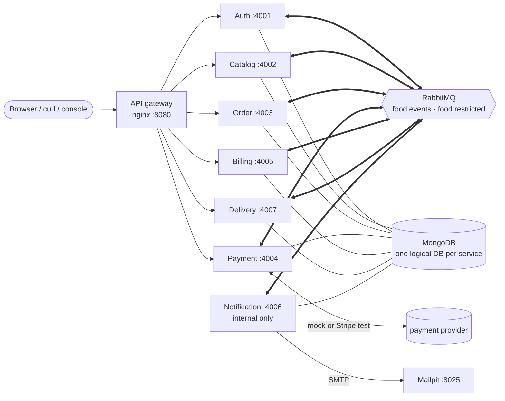

# Team handover

**Start here.** This guide is for teammates joining the project. It explains what the system does and how the parts fit together. It also covers how to run and test it locally and what you need before deploying it.
It links to the detailed documents rather than repeating them. The code is the source of truth. Anything this guide could not
establish from the repository is marked **unverified**.

Contents: [1 Overview](#1-project-overview) · [2 Stack](#2-technology-stack) · [3 Architecture](#3-architecture-summary) ·
[4 Services](#4-microservice-responsibilities) · [5 Repository](#5-repository-navigation) · [6 Order lifecycle](#6-complete-order-lifecycle) ·
[7 Events](#7-event-driven-communication) · [8 Databases](#8-database-architecture) · [9 Auth & RBAC](#9-authentication-and-authorization) ·
[10 Local setup](#10-local-setup) · [11 Testing](#11-testing) · [12 Cloud prerequisites](#12-cloud-deployment-prerequisites) ·
[13 Limitations](#13-known-limitations) · [14 Reading order](#14-recommended-reading-order)

---

## 1. Project overview

This is a food ordering backend in the style of Swiggy or Zomato, built for a university cloud computing course. Customers browse restaurants, order, pay (with a mock card
provider) and track the delivery live. Delivery partners pick the order up and confirm the handover with a 6-digit code that the customer receives by
email. Restaurant administrators manage their menus, and platform administrators manage everything.

It is built as **seven microservices** that communicate **only through RabbitMQ events**. Each service has its own logical MongoDB database. Clients reach the
services through one **API gateway** (nginx). The project runs locally with Docker Compose and **has not been deployed to any cloud yet**.

All data is fictional. Money is always stored as **integer paise** (₹249.00 = `24900`).

## 2. Technology stack

| Layer | Technology |
|---|---|
| Runtime / language | Node.js ≥ 24, TypeScript 7 (ESM, strict), npm workspaces monorepo |
| HTTP | Express 5, zod validation, helmet, pino JSON logs |
| Data | MongoDB 8 (single-node **replica set** locally; needed for transactions and change streams), Mongoose |
| Messaging | RabbitMQ 4.1 (topic exchange `food.events` + direct exchange `food.restricted`), `amqp-connection-manager` |
| Auth | HS256 JWT (shared secret, verified locally by every service), bcrypt |
| Payments | mock provider (default, simulated) or Stripe **test mode** (real Stripe mode not yet verified) |
| Email | SMTP via Nodemailer → **Mailpit** (captures mail; nothing reaches a real inbox) |
| Gateway | nginx 1.29 (path-based reverse proxy, no business logic) |
| Tests | Vitest, Supertest, MongoDB Memory Server, real-RabbitMQ integration tests, end-to-end Node scripts |
| Web frontend | React 19, TypeScript, Vite, React Router in `frontend/` (static files served by nginx, :3000) |
| Dev tooling | `tools/devtools`: testing console, Swagger UI (OpenAPI 3.1), read-only observability helpers |
| Local orchestration | Docker Compose (on WSL 2 + Docker Desktop on the original machine) |

## 3. Architecture summary



The architecture follows five rules. Details are in [ARCHITECTURE.md §1](ARCHITECTURE.md#1-system-overview) and [§16](ARCHITECTURE.md#16-final-communication-architecture-event-driven-choreography).

1. **Clients use REST, and only through the gateway.** The Notification Service, RabbitMQ and MongoDB have no gateway route.
2. **Services never call each other over HTTP.** They publish facts as events and react to other services' events (choreography). No central
   orchestrator exists.
3. **Each service owns its data.** If a service needs another service's data, it keeps a local copy built from events. For example, the Order Service keeps a
   *catalog projection* of every restaurant and menu.
4. **Events are never lost and never applied twice.** Every publisher writes the event in the same MongoDB transaction as the change
   (transactional outbox). Every consumer acknowledges manually, retries, dead-letters what keeps failing and ignores duplicates.
5. **The Order Service is the only authority on order status.** Payment and delivery facts arrive as events, and the Order Service decides
   whether each one is a legal transition.

## 4. Microservice responsibilities

Each service has a full reference card in [ARCHITECTURE.md §21](ARCHITECTURE.md#21-service-reference). The card covers the directory, Dockerfile, port, endpoints, events, collections, workers, health and env.

| Service | Owns (database) | Responsibilities | Publishes | Consumes |
|---|---|---|---|---|
| **Auth** `services/auth` :4001 | users (`auth_db`) | registration (customers only), login/JWT, profile & addresses, platform-admin user management, deactivation, permanent deletion of inactive accounts | `auth.user.deactivated.v1`, `auth.user.deleted.v1` | `delivery.partner_assigned/completed/cancelled.v1` (agent-delivery projection) |
| **Catalog** `services/catalog` :4002 | restaurants, menu items, admin assignments (`catalog_db`) | browsing/search, restaurant & menu management, many-to-many `adminIds`, seeding | `catalog.restaurant.updated.v2` | `catalog.sync_requested.v1`, `auth.user.deactivated.v1`, `auth.user.deleted.v1` |
| **Order** `services/order` :4003 | orders, catalog projection (`order_db`) | placement priced from its projection, cancellation, **order status authority**, expiry worker, tracking + SSE | `order.created/confirmed/cancelled/expired.v1`, `order.status_changed.v1`, `catalog.sync_requested.v1` | `catalog.*`, `billing.finalized`, `payment.*`, `delivery.*` |
| **Payment** `services/payment` :4004 | payments, refunds (`payment_db`) | one payment per order, charges only Billing's `finalAmount`, mock/Stripe providers, signed webhooks, refunds, reconciler | `payment.succeeded/failed/cancelled.v1`, `payment.refund.completed/failed.v1` | `order.created/cancelled/expired`, `billing.finalized` |
| **Billing** `services/billing` :4005 | invoices, ledger, discounts (`billing_db`) | immutable itemised invoices, discount codes, final payable amount, credit/void ledger entries | `billing.finalized.v1` | `order.created/cancelled/expired`, `payment.succeeded`, `payment.refund.*` |
| **Delivery** `services/delivery` :4007 | deliveries, partners, OTP verifiers (`delivery_db`) | simulated preparation, random atomic partner assignment, partner API, OTP issue/verify | `delivery.*.v1`, restricted `notification.delivery_otp.v1` | `order.confirmed/cancelled/expired` |
| **Notification** `services/notification` :4006 (internal) | notification records (`notification_db`) | turns status changes into HTML + text emails, emails delivery codes, durable SMTP retries | nothing | `order.#` (acts on `order.status_changed.v1`), restricted `notification.delivery_otp.v1` |

Supporting components:

| Component | Where | Role |
|---|---|---|
| API gateway | `infra/nginx` (image `food/gateway`) | single entry point on :8080; routes `/auth`, `/restaurants`, `/orders`, `/payments`, `/invoices`, `/discounts`, `/deliveries`, `/health/<svc>`; rate-limits `/auth/*`; SSE passthrough |
| RabbitMQ | image `rabbitmq:4.1-management-alpine` | event bus; durable queues per consumer; per-service users with least privilege |
| `rabbitmq-setup` | `infra/rabbitmq-setup` | one-shot job on every `up`: creates exchanges, per-service users and permissions, then exits (0) |
| MongoDB | image `mongo:8.0` | one server, seven logical databases; replica set `rs0` initiated by the healthcheck |
| Mailpit | image `axllent/mailpit:v1.31.6` | captures every email (UI/API :8025, SMTP :1025). **Kept for the final demo** ([§12](#12-cloud-deployment-prerequisites)) |
| **Web application** | `frontend/` (:3000; image `food/frontend`) | the user-facing React app for all four roles: browse, order, simulated payment, live tracking, restaurant and menu management, delivery actions, user and assignment administration. It calls only the gateway, using the user's JWT ([frontend/README.md](frontend/README.md)) |
| Testing console | `tools/devtools` (:3100, bound to 127.0.0.1) | role-aware browser UI, Swagger UI, health/queue/DLQ/event/email views. **Development only.** It calls the gateway like any client and has no database access |

## 5. Repository navigation

```
.
├── packages/common/          @food/common: shared infrastructure (no business rules)
│   └── src/
│       ├── events/           contracts.ts (zod schemas + versions of EVERY event), envelope.ts (routing keys)
│       ├── messaging/        broker.ts (RabbitMQ: confirms, reconnects, retry queue, DLQ)
│       ├── outbox/           enqueue.ts (write event in the business transaction), relay.ts (publish), outbox.model.ts
│       ├── http/             base app, auth/RBAC middleware, validation, error handler, /health
│       ├── idempotency.ts    processOnce(): at-most-once effects per (consumer, eventId)
│       ├── auth.ts, config.ts, db.ts, errors.ts, logger.ts, lifecycle.ts, crypto/sealed-box.ts
├── services/<name>/          one directory per microservice (auth, catalog, order, payment, billing, delivery, notification)
│   ├── Dockerfile            multi-stage build; build context = repository root
│   ├── .env.example          variables for running the service on the host (`npm run dev`)
│   ├── src/
│   │   ├── server.ts         composition root: connect Mongo + RabbitMQ, start relay/workers/consumers, HTTP
│   │   ├── app.ts            Express app (testable, dependencies injected)
│   │   ├── config.ts         zod-validated environment variables (the authoritative list per service)
│   │   ├── routes/           HTTP routes (validation → service call → response); there are no separate controllers
│   │   ├── services/         business logic (+ workers: order/expiration.worker.ts, payment/reconciler.ts)
│   │   ├── models/           Mongoose schemas and indexes
│   │   ├── consumers/        RabbitMQ event consumers (queue names + bindings)
│   │   ├── schemas.ts        zod request schemas
│   │   └── seed/ workers/ providers/ templates/ catalog/ tracking/   (service-specific)
│   └── test/                 Vitest suites (in-memory MongoDB)
├── infra/nginx/              gateway image (nginx.conf = all routes)
├── infra/rabbitmq-setup/     broker provisioning job (setup.mjs = users, permissions, exchanges)
├── frontend/                 React web app (own package.json, Dockerfile; not an npm workspace)
├── tools/devtools/           testing console + Swagger UI + observability helpers (dev only)
├── docs/openapi.mjs          OpenAPI source → docs/openapi.json (generated; checked against code)
├── scripts/                  init-env, seed-delivery-agents, openapi check, e2e-*.mjs suites, scenarios.mjs
├── docker-compose.yml        the complete local environment
├── .env.example              template for the git-ignored .env
└── *.md                      documentation (see §14)
```

| Looking for… | Go to |
|---|---|
| An endpoint's code | `services/<svc>/src/routes/*.routes.ts` → `services/<svc>/src/services/*.service.ts` |
| A database schema / index | `services/<svc>/src/models/*.model.ts` (Order's projection: `services/order/src/catalog/projection.model.ts`) |
| An event's payload | `packages/common/src/events/contracts.ts` |
| Who consumes an event | `services/<svc>/src/consumers/*.ts` (queue name + routing keys at the top of each file) |
| Broker users / permissions | `infra/rabbitmq-setup/setup.mjs` |
| Gateway routes | `infra/nginx/nginx.conf` |
| Environment variables | `services/<svc>/src/config.ts` (defaults) and `docker-compose.yml` (values used locally) |
| Seed data | `services/catalog/src/seed/` (full demo catalog `data.ts`, 5-restaurant `sample-data.ts`), `services/billing/src/seed/discounts.ts`, `scripts/seed-delivery-agents.mjs` |
| Tests | `services/<svc>/test/`, `packages/common/test/`, `scripts/e2e-*.mjs`, `scripts/scenarios.mjs` |

## 6. Complete order lifecycle

### 6.1 Successful order, step by step

| # | Stage | Trigger (REST or event) | Responsible service | Event(s) published | Consumed by | State written | Customer email |
|---|---|---|---|---|---|---|---|
| 1 | Registration & login | `POST /auth/register`, `POST /auth/login` | Auth | — | — | `auth_db.users` (bcrypt hash); login returns a 1 h JWT | — |
| 2 | Browse | `GET /restaurants`, `GET /restaurants/:id/menu` | Catalog | — | — | — (reads `catalog_db`) | — |
| 3 | Place order | `POST /orders` (customer JWT, optional `Idempotency-Key`) | Order | `order.created.v1` + `order.status_changed.v1` (pending_payment) | Billing, Payment (created); Notification ignores pending_payment | `order_db.orders` = `pending_payment`, priced from `catalog_restaurants`; `expiresAt` = now + 15 min | none |
| 4 | Invoice | `order.created.v1` | Billing | `billing.finalized.v1` (`finalAmount`) | Payment, Order | `billing_db.invoices` (immutable), `billing_entries` | — |
| 5 | Payment initiation | `POST /payments/initiate` (customer) | Payment | — | — | `payment_db.payments` (record created earlier from `order.created`; amount from `billing.finalized`). Before step 4 completes: `409 BILLING_PENDING` | — |
| 6 | Mock payment confirmation | `POST /payments/:id/simulate` (dev only) → mock provider sends a **signed webhook** → `POST /payments/webhook` | Payment | `payment.succeeded.v1` | Order, Billing | payment `succeeded`; billing ledger records the charge | — |
| 7 | Order confirmation | `payment.succeeded.v1` | Order | `order.confirmed.v1` + `order.status_changed.v1` (confirmed) | Delivery (confirmed), Notification | order `confirmed`, `paymentStatus = paid` | **ORDER_CONFIRMED** (confirmed + paid) |
| 8 | Delivery preparation | `order.confirmed.v1` → scheduler after `PREPARATION_DELAY_MS` (15 s locally) | Delivery | `delivery.ready_for_pickup.v1` | Order → `order.status_changed.v1` | `delivery_db.deliveries` `preparing` → `awaiting_partner`; order `assigning_delivery_partner` | **DELIVERY_ASSIGNING** |
| 9 | Partner assignment | scheduler (random available partner, atomic reservation, bounded retries) | Delivery | `delivery.partner_assigned.v1` (display name, masked phone) | Order → `status_changed` | delivery + agent reserved; order `partner_assigned` | **DELIVERY_PARTNER_ASSIGNED** |
| 10 | Pickup | `POST /deliveries/:id/pickup` (assigned partner's JWT) | Delivery | `delivery.picked_up.v1` | Order → `status_changed` | delivery `picked_up`; order `out_for_delivery` | **OUT_FOR_DELIVERY** |
| 11 | Arrival | `POST /deliveries/:id/arrived` (assigned partner) | Delivery | `delivery.location_reached.v1` (no OTP inside) | Order → `status_changed` | delivery `arrived`; order `location_reached` | **AGENT_ARRIVED** |
| 12 | OTP generation & email | same request as 11 | Delivery → Notification | `notification.delivery_otp.v1` on **`food.restricted`** (OTP sealed with Notification's public key) | Notification only | `delivery_otps` stores only an HMAC verifier (5 min TTL, 5 attempts, ≤ 3 codes) | **DELIVERY_OTP** (the code; visible in Mailpit) |
| 13 | OTP verification | `POST /deliveries/:id/verify-otp` (assigned partner submits the customer's code) | Delivery | — (until valid) | — | attempts counted; wrong code → 422, locked after 5 → 423, expired → 410 | — |
| 14 | Delivery completion | valid OTP | Delivery | `delivery.completed.v1` (`otpVerified: true`) | Order | delivery `delivered`, partner released | — |
| 15 | Final status | `delivery.completed.v1` | Order | `order.status_changed.v1` (delivered) | Notification | order `delivered` (terminal) | **ORDER_DELIVERED** |

Every accepted transition is appended to `order.statusHistory` with the source event and service. The customer can follow progress with
`GET /orders/:id/tracking` or live with `GET /orders/:id/tracking/stream` (Server-Sent Events fed by a MongoDB change stream).

### 6.2 Sequence diagram

```mermaid
sequenceDiagram
    autonumber
    actor C as Customer
    actor A as Delivery partner
    participant GW as Gateway
    participant AU as Auth
    participant CA as Catalog
    participant O as Order
    participant B as Billing
    participant P as Payment
    participant D as Delivery
    participant MQ as RabbitMQ
    participant N as Notification
    participant M as Mailpit

    C->>GW: POST /auth/register, /auth/login
    GW->>AU: forward
    AU-->>C: JWT (1 h)
    C->>GW: GET /restaurants, /restaurants/:id/menu
    GW->>CA: forward
    CA-->>C: restaurants, menu
    Note over CA,O: Catalog changes reach Order as catalog.restaurant.updated.v2 (projection)
    C->>GW: POST /orders
    GW->>O: forward
    O->>O: price from local projection; txn: order + outbox
    O-->>C: 201 pending_payment
    O--)MQ: order.created.v1, order.status_changed.v1
    MQ--)B: order.created
    MQ--)P: order.created (payment record)
    B--)MQ: billing.finalized.v1 (finalAmount)
    MQ--)P: billing.finalized (amount to charge)
    MQ--)O: billing.finalized (mirror)
    C->>GW: POST /payments/initiate
    GW->>P: forward
    P-->>C: payment (requires_action)
    C->>GW: POST /payments/:id/simulate (mock card step)
    GW->>P: forward
    P->>P: mock provider → signed webhook → verified
    P--)MQ: payment.succeeded.v1
    MQ--)O: payment.succeeded
    MQ--)B: payment.succeeded (ledger)
    O--)MQ: order.confirmed.v1, order.status_changed.v1 (confirmed)
    MQ--)N: status_changed → ORDER_CONFIRMED email
    N->>M: SMTP
    MQ--)D: order.confirmed → delivery (preparing)
    D--)MQ: delivery.ready_for_pickup.v1 (after preparation delay)
    MQ--)O: → assigning_delivery_partner (+ email)
    D--)MQ: delivery.partner_assigned.v1 (random available partner)
    MQ--)O: → partner_assigned (+ email)
    A->>GW: POST /deliveries/:id/pickup
    GW->>D: forward
    D--)MQ: delivery.picked_up.v1
    MQ--)O: → out_for_delivery (+ email)
    A->>GW: POST /deliveries/:id/arrived
    GW->>D: forward
    D--)MQ: delivery.location_reached.v1 (food.events)
    D--)N: notification.delivery_otp.v1 (food.restricted, sealed OTP)
    MQ--)O: → location_reached (+ email)
    N->>M: DELIVERY_OTP email (code)
    C-->>A: tells the code
    A->>GW: POST /deliveries/:id/verify-otp
    GW->>D: forward
    D--)MQ: delivery.completed.v1
    MQ--)O: → delivered
    O--)MQ: order.status_changed.v1 (delivered)
    MQ--)N: ORDER_DELIVERED email
    N->>M: SMTP
```

### 6.3 Cancellation, refunds, expiry and failure paths

| Path | What happens | Details |
|---|---|---|
| **Cancellation** | `POST /orders/:id/cancel`. Customer may cancel in `pending_payment`/`confirmed`. An administrator of the order's restaurant may also cancel in `assigning_delivery_partner`. A platform admin may also cancel in `partner_assigned`. After pickup nobody can cancel (`409 ORDER_NOT_CANCELLABLE`). The Order Service publishes `order.cancelled.v1` + `status_changed` (ORDER_CANCELLED email) | [ARCHITECTURE §18.7](ARCHITECTURE.md#187-cancellation-policy) |
| **Refund** | If the order was paid, Order sets `paymentStatus = refund_pending`. Payment consumes `order.cancelled` and refunds automatically → `payment.refund.completed.v1` (or `failed`). Billing records a credit note. Delivery cancels its record and releases the partner (`delivery.cancelled.v1`). Platform admins can also refund manually (`POST /payments/:id/refund`, partial or full) | [§13.7](ARCHITECTURE.md#137-cancellation-and-refund) |
| **Unpaid expiry** | The Order Service's expiration worker (every 15 s) marks unpaid orders older than `ORDER_PAYMENT_DEADLINE_SECONDS` (900) as `expired`. It never deletes them. It then publishes `order.expired.v1`, which sends the ORDER_EXPIRED email. Payment cancels the open intent or refunds a payment that arrived too late. Billing voids the invoice | [§14](ARCHITECTURE.md#14-automatic-expiration-of-unpaid-orders) |
| **Payment declined** | `payment.failed.v1` (retryable). The order stays `pending_payment` and the customer retries on the same payment | [§13](ARCHITECTURE.md#13-payment-architecture-stage-4) |
| **No partner available** | After bounded retries Delivery publishes `delivery.assignment_failed.v1`. The order stays `assigning_delivery_partner` with a `deliveryIssue`. There is no automatic refund. A platform admin calls `POST /deliveries/:id/retry-assignment` or cancels the order | [§18.8](ARCHITECTURE.md#188-failure-handling) |
| **OTP problems** | Wrong code → 422; 5 wrong → 423 locked; expired → 410. The partner can request a new code (`resend-otp`, 30 s cooldown, ≤ 3 codes) | [§18.5](ARCHITECTURE.md#185-sequence-otp-generation-and-verification) |
| **Billing not finalized** | `POST /payments/initiate` → `409 BILLING_PENDING` + `Retry-After` until `billing.finalized` arrives | [§16.6](ARCHITECTURE.md#166-billing--payment-without-http) |
| **Broker outage** | Writes still commit and events wait in each outbox. New orders are refused with 503 `CATALOG_SYNC_UNAVAILABLE`, because the projection may be stale. Everything catches up after recovery | [§7](ARCHITECTURE.md#7-reliability) |
| **Notification/SMTP outage** | Orders are unaffected; events wait in the durable queue; emails are retried (≤ 8 attempts) | [§17](ARCHITECTURE.md#17-notification-service) |

## 7. Event-driven communication

- **Exchanges.** There are two:
  - `food.events` (topic, durable) carries every business event;
  - `food.restricted` (direct, durable) carries only the OTP command. Only `delivery-service` may write to it and only `notification-service` may read from it.
- **Routing key** = `<eventType>.v<version>`, e.g. `order.created.v1`, `catalog.restaurant.updated.v2`.
- **Queues.** Each consumer owns a durable queue `<service>.<purpose>`. Each queue has a `.retry` queue (TTL, then back into the main queue), a `.dlq` queue and a
  `.parking` exchange that routes retries and dead letters.
- **Outbox (publishing).** The event is written to the service's `outbox_events` collection in the same transaction as the business change. A relay
  publishes it with publisher confirms, marks it `published`, and retries with backoff while RabbitMQ is down.
- **Consumers.** Messages are acknowledged manually after the handler succeeds. Failed messages are retried 3–8 times with a 2–5 s delay, depending on the consumer. Contract violations go straight to the DLQ.
  Duplicates are harmless, through one of three mechanisms:
  - `processOnce` (a `processed_events` record in the same transaction);
  - a monotonic version check (Order's catalog projection);
  - a unique business key (Notification's `dedupeKey`, Catalog's state-based cleanup).
- **Per-service broker users.** Each service has its own RabbitMQ user, which:
  - may publish only its own routing-key prefix (topic permissions);
  - may read and configure only its own queues;
  - may not write to the default exchange.

**Current event matrix** (retired versions are not listed; `catalog.restaurant.updated.v1` was retired in Stage 8.2):

| Event | Publisher | Consumers | Purpose |
|---|---|---|---|
| `auth.user.deactivated.v1` | Auth | Catalog, Delivery | an active account was deactivated → remove it from every restaurant's `adminIds` (assignments made before `deactivatedAt` only); block an agent from new deliveries |
| `auth.user.deleted.v1` | Auth | Catalog, Delivery | an inactive account was permanently deleted → tombstone the id and remove **all** its assignments; block an agent permanently. Business records are kept |
| `catalog.restaurant.updated.v2` | Catalog | Order | full restaurant + menu snapshot incl. `adminIds` (on every change, at startup, every 5 min, on request); applied only if `catalogVersion` is newer |
| `catalog.sync_requested.v1` | Order | Catalog | "please re-broadcast all snapshots" (Order's projection is empty) |
| `order.created.v1` | Order | Payment, Billing | new order: items, totals, deadline, discount code |
| `order.confirmed.v1` | Order | Delivery | order paid and confirmed → start a delivery |
| `order.cancelled.v1` | Order | Payment, Billing, Delivery | refund/void, stop the delivery |
| `order.expired.v1` | Order | Payment, Billing, Delivery | unpaid at the deadline → cancel intent / void invoice / tombstone |
| `order.status_changed.v1` | Order | Notification | customer-facing projection of every accepted transition (the only email trigger for order emails) |
| `billing.finalized.v1` | Billing | Payment, Order | authoritative payable `finalAmount` (Payment charges only this) |
| `payment.succeeded.v1` | Payment | Order, Billing | confirms the order; ledger entry |
| `payment.failed.v1` · `payment.cancelled.v1` | Payment | Order | mirror payment status (retry allowed after failure) |
| `payment.refund.completed.v1` · `payment.refund.failed.v1` | Payment | Order, Billing | refund outcome; credit note |
| `delivery.ready_for_pickup.v1` · `delivery.partner_assigned.v1` · `delivery.picked_up.v1` · `delivery.location_reached.v1` · `delivery.completed.v1` | Delivery | Order | drive the order through the fulfilment statuses |
| `delivery.cancelled.v1` · `delivery.assignment_failed.v1` | Delivery | Order | mirrored on the order (no status change) |
| `notification.delivery_otp.v1` (**food.restricted**) | Delivery | Notification | email the sealed OTP to the customer |

`billing.invoice_generated.v1` is a deprecated alias of `billing.finalized.v1`: it is no longer published, but Payment and Order still bind to it.
Payload schemas are in `packages/common/src/events/contracts.ts`. The detailed matrix with business keys, the queue list and permissions are in
[ARCHITECTURE §16.3](ARCHITECTURE.md#163-event-matrix) and [§16.8](ARCHITECTURE.md#168-rabbitmq-topology-and-per-service-permissions-implemented-in-stage-6).

**Local projections instead of queries.** The Order Service prices orders from `catalog_restaurants`, its local copy of the catalog, and checks restaurant
administrators against that copy too. Payment learns the amount from `billing.finalized` and the deadline from `order.created`. Billing learns
payments from `payment.*`. Delivery gets the customer's email from `order.confirmed`. No service reads another service's database, and none asks another service
over HTTP.

**Eventual consistency.** A change becomes visible to other services after its event is consumed, normally within milliseconds. During a
broker outage the events wait in each outbox and in durable queues. Recovery is automatic:
- connections and topology are re-declared on reconnect;
- the relays resume;
- the Catalog re-broadcasts snapshots periodically as a repair mechanism.

## 8. Database architecture

Locally, **one MongoDB container** (`mongo:8.0`, replica set `rs0`, volume `mongo-data`) hosts **seven logical databases**. This is
*physically shared, logically separate*: each service gets a connection string for its own database only and never touches another.
The services do not enforce that isolation themselves: it holds by convention, and locally MongoDB has no authentication. In the cloud, give each service its own
database user scoped to its own database.

| Database | Owner | Key collections |
|---|---|---|
| `auth_db` | Auth | `users` (unique `email`), `agent_deliveries` (projection), `locks`, `outbox_events` |
| `catalog_db` | Catalog | `restaurants` (unique `slug`, `adminIds` index), `menuitems` (unique `restaurantId + name`), `deleted_users` (tombstones), `outbox_events` |
| `order_db` | Order | `orders` (unique `orderNumber`, unique `customerId + idempotencyKey`), `catalog_restaurants` (projection), `outbox_events`, `processed_events` |
| `payment_db` | Payment | `payments` (unique `orderId`), `refunds` (unique `idempotencyKey`), `mock_provider_objects`, `outbox_events`, `processed_events` |
| `billing_db` | Billing | `invoices` (immutable, unique `orderId`), `billing_entries` (immutable ledger), `discounts` (unique `code`), `outbox_events`, `processed_events` |
| `delivery_db` | Delivery | `deliveries` (unique `orderId`), `delivery_agents` (unique `activeDeliveryId`), `delivery_otps` (one active per delivery), `account_blocks`, `outbox_events`, `processed_events` |
| `notification_db` | Notification | `notifications` (unique `dedupeKey` = order + status) |

**Why one service must never write another's database.** If it did:
- the owner's invariants would be bypassed (state machines, immutability, version counters);
- no event would be published, so the other services' projections would silently diverge;
- schemas could no longer change independently;
- the database could not later be split onto separate servers.

Cross-service references are plain ids, never joins. Details are in [ARCHITECTURE §4](ARCHITECTURE.md#4-database-ownership): indexes, the
replica set, volumes, startup migrations and seeding.

## 9. Authentication and authorization

- **Public registration** (`POST /auth/register`) always creates a `customer`.
- **Privileged accounts** (`restaurant_admin`, `delivery_agent`, `platform_admin`) are created only by a signed-in platform admin through `POST /auth/users`.
  The first platform admin is bootstrapped from `ADMIN_EMAIL` / `ADMIN_PASSWORD` when Auth starts.
- **JWT.** Auth signs an HS256 token (`sub`, `role`, issuer `food-auth-service`, audience `food-platform`, expiry `JWT_EXPIRES_IN` = 1 h). Every
  service verifies it **locally** with the shared `JWT_SECRET`; there is no call to Auth. Routes check the role, and the business layer checks ownership. Someone else's
  resource returns 404, so its existence is not revealed.

| Capability | customer | restaurant_admin | delivery_agent | platform_admin |
|---|:-:|:-:|:-:|:-:|
| Browse restaurants & menus | ✅ | ✅ | ✅ | ✅ (incl. inactive) |
| Place / pay own orders | ✅ | — | — | — |
| View / cancel orders | own | of **assigned** restaurants | the one assigned to them (view) | all |
| Create restaurants | — | — | — | ✅ |
| Update restaurant details, open/close, menu, prices, availability | — | **assigned** restaurants | — | ✅ |
| Assign / remove restaurant administrators | — | — | — | ✅ |
| Pickup / arrival / OTP actions | — | — | **assigned** deliveries only | — |
| Users, refunds, discounts, delivery operations | — | — | — | ✅ |

- **Restaurant administrators.** The model is **many-to-many**: a restaurant's `adminIds` lists the restaurant administrators assigned to it.
  - All of them have identical permissions; there is no owner hierarchy.
  - Only platform admins create restaurants (optionally with initial `adminIds`) and add or remove administrators (`POST /restaurants/:id/admins`, `DELETE /restaurants/:id/admins/:userId`).
  - `GET /restaurants/mine` lists the caller's restaurants.
  - Customers never see `adminIds`.
- **Delivery agents** act only on deliveries whose `agentId` equals their JWT `sub`. Any other delivery returns 404.
- **Deactivation.** `PATCH /auth/users/:id/status {"isActive": false}`:
  - immediately blocks login and Auth's profile endpoints;
  - publishes `auth.user.deactivated.v1`;
  - Catalog then removes the user from every restaurant they were assigned to before the deactivation, and the Order Service follows through `catalog.restaurant.updated.v2`.
  - Delivery blocks a deactivated agent from new deliveries until they sign in again after reactivation.
  - The last active platform admin cannot be deactivated (409 `LAST_ACTIVE_ADMIN`).
- **Reactivation** restores **no** assignments; a platform admin re-assigns explicitly.
- **Permanent deletion** (Stage 9). `DELETE /auth/users/:id` (platform admin):
  - accepts only **inactive** accounts, never your own;
  - refuses a delivery agent who still holds an active delivery;
  - removes the Auth record and publishes `auth.user.deleted.v1` in the same transaction;
  - Catalog then removes every assignment of the id and refuses it from then on, and Delivery blocks the agent permanently;
  - orders, payments, invoices, ledger, delivery history and notifications are **kept** and still contain the user id and captured details. This is not personal-data erasure.

  Details: [ARCHITECTURE §23](ARCHITECTURE.md#23-permanent-account-deletion-stage-9).
- **Known limitation.** A deactivated or deleted user's existing JWT stays cryptographically valid until it expires (≤ 1 h). Services other than Auth accept it for its
  remaining lifetime. Restaurant access ends earlier, once the event has been processed. There are no refresh tokens and no revocation list.

Details: [ARCHITECTURE §9](ARCHITECTURE.md#9-security) and [§20](ARCHITECTURE.md#20-restaurant-administration-many-to-many-assignments-stage-82).

## 10. Local setup

Prerequisites:
- Docker Desktop with Compose. On WSL 2, enable *Settings → Resources → WSL integration* for your distro.
- Node.js ≥ 24.
- Git.

### First-time setup

```bash
npm install
```

```bash
node scripts/init-env.mjs
```

This creates the git-ignored `.env` from `.env.example`. It generates the JWT secret, the admin password, one RabbitMQ password per service, the OTP keys and the demo
partners' password. Existing values are never changed and nothing is printed. Set `ADMIN_EMAIL` (and optionally `ADMIN_NAME`) in `.env` yourself.

```bash
docker compose up -d --build
```

```bash
docker compose ps
```

Every long-running container should become `healthy`. `rabbitmq-setup` shows `Exited (0)`, which is expected.

Seed data, all optional, idempotent and never overwriting edits:

| What | How |
|---|---|
| Full demo catalog (16 restaurants, 162 items, some closed/unavailable on purpose) | `SEED_ON_START=true` in `.env` (the Compose default if unset), then `docker compose up -d catalog-service` |
| Small sample catalog (5 open restaurants × 5 items, no administrators) | `docker exec food-platform-catalog-service-1 node services/catalog/dist/seed/run.js --sample` |
| 12 fictional delivery partners | `node scripts/seed-delivery-agents.mjs` (uses `ADMIN_*` and `DELIVERY_AGENT_PASSWORD` from `.env`) |
| Discount codes | automatic (`SEED_DISCOUNTS=true` in Compose) |

> On the original development machine `.env` sets `SEED_ON_START=false`, and the catalog holds only the 5-restaurant sample. Check your own `.env`.

### Daily use

| Task | Command / URL |
|---|---|
| Start (after Docker Desktop is running) | `docker compose up -d` |
| Health | `docker compose ps` · http://localhost:8080/health/order (etc.) · the console's health card |
| Web application | http://localhost:3000 (dev server: `cd frontend && npm run dev` → :5173) |
| Testing console / Swagger UI | http://localhost:3100 · http://localhost:3100/docs |
| API gateway | http://localhost:8080 |
| RabbitMQ management | http://localhost:15672 (admin `RABBITMQ_USER` / `RABBITMQ_PASSWORD` from `.env`) |
| Mailpit | http://localhost:8025 |
| Logs | `docker compose logs -f order-service` (JSON lines; `grep <orderId>` to follow an order) |
| Restart one service | `docker compose restart order-service` |
| Rebuild one service after code changes | `docker compose up -d --build order-service` |
| Stop (keeps data) | `docker compose stop` (or `docker compose down`, which removes containers but **keeps the volumes**) |

> **Never run `docker compose down -v`** unless you really want to erase all MongoDB and RabbitMQ data. It deletes the `mongo-data` and `rabbitmq-data` volumes.

More detail: [TESTING_GUIDE.md](TESTING_GUIDE.md), which covers the console walkthrough, Swagger, Mailpit, RabbitMQ and a troubleshooting table.

## 11. Testing

| Suite | Command | Needs Docker? | Data |
|---|---|---|---|
| Unit + in-process integration (all packages) | `npm test` | no | temporary in-memory MongoDB (MongoDB Memory Server); runs the OpenAPI check at the end |
| + real RabbitMQ / Mailpit | `RABBITMQ_TEST_URL=amqp://food:<RABBITMQ_PASSWORD>@localhost:5672 MAILPIT_URL=http://localhost:8025 npm test` | RabbitMQ (+ Mailpit) | temporary queues on the local broker; one test email to Mailpit |
| + Stripe request shapes | start `stripe/stripe-mock` on :12111, add `STRIPE_MOCK_URL=http://localhost:12111` | stripe-mock container | none (not real Stripe) |
| Type check / OpenAPI check | `npm run typecheck` · `node scripts/openapi.mjs check` | no | none |
| End-to-end suites and scenario runner | `node scripts/e2e-*.mjs`, `node scripts/scenarios.mjs all` | full stack | **persistent** accounts, orders, payments, deliveries and emails in your local databases |

Several E2E suites **stop or recreate containers**. Some also **depend on the full demo catalog**, for example the "Spice Route Biryani House" restaurant.
Read [TESTING_GUIDE §5](TESTING_GUIDE.md#5-full-regression) before running them. This handover milestone ran **no** tests.

## 12. Cloud deployment prerequisites

[DEPLOYMENT_GUIDE.md](DEPLOYMENT_GUIDE.md) is the reference for deployment. In short:
- **Images to deploy:**
  - 7 service images;
  - the gateway;
  - the one-shot `rabbitmq-setup` job;
  - MongoDB, RabbitMQ and Mailpit, as managed services or containers.
- **Keep private:** MongoDB, RabbitMQ (and its management UI), the Notification Service, Mailpit's UI and the testing console.
- **Make public:** the gateway and the web frontend (static files; its `API_URL` must be the gateway's public URL).
- **Mailpit stays the email backend** for the academic demo. It captures mail instead of delivering it, so fictional addresses work and delivery codes show up in its inbox.
  That inbox is shared and unauthenticated, so restrict its UI to project members.
- **Blockers to resolve before a cloud run** are listed in DEPLOYMENT_GUIDE §12. They include:
  - the gateway's Docker-only DNS resolver and hard-coded hostnames;
  - MongoDB needing a replica set with authentication;
  - secret distribution;
  - provisioning broker users on a managed RabbitMQ (unverified).

Docker Compose is a **local development** tool here. It is not a production orchestrator.

## 13. Known limitations

The full list is in [PROGRESS.md → Known issues](PROGRESS.md#known-issues-and-limitations). The most relevant:

1. JWTs stay valid until expiry (≤ 1 h) after deactivation or deletion; there are no refresh tokens or revocation list (smallest fix: an event-fed `iat` cut-off per user, ARCHITECTURE §23.5).
2. Real Stripe test mode is **unverified**; everything was run with the mock provider.
3. No cloud deployment, no CI pipeline, no multi-replica or load tests.
4. Emails are captured by Mailpit only (by design for the demo). Mailpit has no volume: recreating it empties the inbox.
5. During a RabbitMQ outage new orders are refused (503) on purpose, and access changes and notifications are eventually consistent.
6. Delivery: random assignment, simulated preparation, no pickup timeout or reassignment, and OTP by email only.
7. Restaurant administrator ids are not checked against Auth, because Catalog has no user projection by design. Every permission check also requires the caller's JWT role to be `restaurant_admin`.
8. `e2e-smoke`, `e2e-payments` and `e2e-billing` assume the full 16-restaurant demo catalog.

## 14. Recommended reading order

1. **This file**: the big picture.
2. [frontend/README.md](frontend/README.md): the web app, if you work on the UI.
3. [README.md](README.md): quick start and the documentation map.
4. [TESTING_GUIDE.md](TESTING_GUIDE.md) §1–3: start the stack and click through an order in the console.
5. [ARCHITECTURE.md](ARCHITECTURE.md):
   - §1–§8 for the core design;
   - §16 for events;
   - §21 for one card per service;
   - §20 for restaurant administration;
   - §13–§18 as reference when you work on payments, billing, notifications or delivery.
6. [API.md](API.md) and Swagger UI (http://localhost:3100/docs): endpoints, payloads and error codes.
7. [DEPLOYMENT_GUIDE.md](DEPLOYMENT_GUIDE.md): before any cloud work.
8. [PROGRESS.md](PROGRESS.md): history of each stage, test results and known issues.
